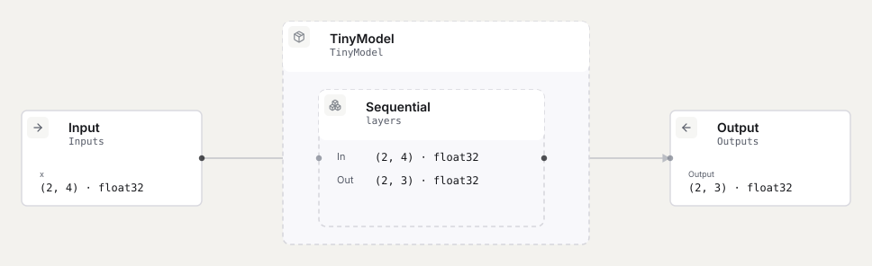

# TensorViz Mac acceptance — 2026-11-14

The **published 0.1.45 extension passed its isolated CLI lifecycle and 8 backend checks; graphical acceptance is blocked** by native computer-control timeouts. Published plugins 0.1.44 and 0.1.45 passed scoped Mac lifecycle/static checks; plugin model capture remained permission-blocked. Actual published 0.1.44 and local eae-source extension graphical observations are separately recorded below. This does not establish exhaustive desktop, model-matrix, website-upload or cross-platform acceptance.

Host: **macOS 26.4 (25E246), arm64**. VS Code **1.145.2**, arm64,
commit `c4453f8ea430795f941c1b2ff6c9321135a74a02`.
Exact package identities, artifact hashes and environment inventory hashes are
in [provenance.json](provenance.json). This report contains synthetic test data
and reviewed summaries; personal profiles, credentials, raw client logs,
environments and caches are excluded.

The final preservation snapshot found **six of seven** inventoried normal files unchanged, including Codex config/auth, Claude settings/plugin registration and SSH config. **`$HOME/.claude.json` changed** during the run; its cause is unverified and no matching baseline backup was found. Concurrent state was not restored. Normal VS Code settings were not included in the initial hash inventory, so their complete preservation cannot be asserted. Existing normal TensorViz extension versions remained VS Code 0.1.29 and Cursor 0.1.18/0.1.17/0.1.15. Only filenames and boolean outcomes, never credential contents/hashes, appear in the [preservation receipt](extension/settings-preservation-final.json). The earlier seven-of-seven [mid-run result](extension/settings-preservation-midrun.json) remains historical evidence.

## Published 0.1.44 baseline

The extension and plugin packages identify source
`f285a383f628af23ac4992970eeab3b006b1f0d2`. The plugin's public export commit is
`6fff2d501cbe037e2d90b252ee484a446c37bd61`.

**Editor extension CLI lifecycle passed.** A clean isolated install lists
`tensorviz.tensorviz-vscode@0.1.44`. A second isolated profile installs 0.1.43,
upgrades to 0.1.44, lists the expected version at each step, uninstalls, and then
lists no extension. Both VSIX hashes were independently recomputed during report
assembly and their embedded package identities/versions matched. Receipt:
[extension/install-lifecycle.json](extension/install-lifecycle.json).

**The installed 0.1.44 VSIX service fails without Torch.** Its actual bundled
`server_v2:app` exited before HTTP health became available in the arm64
Python 3.12.13 no-Torch environment. An eager `core/op_registry.py` import of
`torch.nn` raised `ModuleNotFoundError`; static projection/discovery/setup were
blocked by startup failure. The supplemental standalone source entry bundled
inside the VSIX failed similarly. This is distinct from the native plugin
runtime and from graphical runtime setup. The fix is already merged in main
(PR #69), where the corresponding service tests pass; it is not present in the
published 0.1.44 baseline. Receipt:
[installed VSIX service](backend/installed-vsix-service-results.json).

| Artifact | SHA-256 |
| --- | --- |
| Extension 0.1.44 VSIX | `cb56724877d9211d4e000ade2277062b7564589a2f9808065371f4f2e4234aa8` |
| Extension 0.1.43 VSIX | `521d0c753e921d29ce820cd4ef3fd0fa5fcb3b58295f297826c0b0c90b3c1139` |
| Plugin 0.1.44 catalog ZIP | `c9309b0d02b6e6f5efa7199718e5ba991d3213b88d1741f19718d85291c96057` |
| Plugin 0.1.44 macOS ARM64 runtime | `78a201724c5ebe2eaaf494826f29799a2c5ac2b4ef3b86bf20d4d75748aef450` |

**Plugin install/static MCP checks passed in isolated Codex and Claude profiles.**
Codex CLI 0.165.0 and Claude Code 2.1.308 each discovered the plugin skill and
29 tools, reported version 0.1.44, and uninstalled successfully. This used a
preverified warm runtime cache. Both clients registered a verified downloaded
local catalog with task-only state/cache path overrides in disposable profiles.
A separate cold archive-prefetch command passed
in 73.48 seconds; that is not a cold client-handshake pass. Runtime manifest
verification covered 281 files. No provider/model turn or signed-in desktop
rendering was performed. Receipts:
[client MCP](plugin/published-0.1.44-client-mcp.json),
[CLI lifecycle](plugin/published-0.1.44-cli-report.json),
[native static server](plugin/published-0.1.44-verified-native-report.json),
[prefetch](plugin/published-0.1.44-prefetch.json), and
[artifact provenance](plugin/published-0.1.44-provenance.json).

**The local ZIP upgrade instructions had a reproducible error.** Codex's
marketplace Git refresh rejects a marketplace registered from an extracted
local directory. Replacing the complete local catalog and reinstalling the
plugin successfully upgraded 0.1.43 to 0.1.44; Claude's corresponding update and
both removals passed. The original failure is retained alongside the corrected
run: [original](plugin/upgrade-0.1.43-to-0.1.44-report.json),
[corrected sequence](plugin/upgrade-0.1.43-to-0.1.44-local-fixed-report.json).
The documentation fix is [draft PR #73](https://github.com/tensorviz-org/tensorviz/pull/73).

**Published plugin capture remains unverified.** The native opener stopped at
the existing permission requirement; the harness created no permission record.
An internal compiled dependency probe returned success with valid Torch but
failed with stderr for missing/broken Torch. These low-level results do not prove
the user-facing capture error path, because it was permission-blocked. See
[capture probe](plugin/published-0.1.44-capture-probe.json).

**Scoped graphical extension checks passed in the actual VS Code UI.** The user
manually trusted only the synthetic fixture after the initial Restricted Mode
block. Clean managed runtime setup installed Python 3.12.14/Torch 2.14.1 in
disposable storage. Automatic inputs captured `[1,4]` → `[1,3]`; selecting
`tiny_model.py::graph_inputs` captured `[2,4]` → `[2,3]`, with 16 graph nodes,
**Traced — shapes measured** and **Validation Passed**. Expanding Sequential and
Linear reached measured addmm/transpose and weight/bias nodes. This is
representative expansion/depth coverage, not an exhaustive module matrix.

An empty selected model interpreter produced a setup screen naming missing
Torch, pydantic, packaging and numpy and offering explicit installation approval;
nothing was installed into that empty environment. The managed **service**
environment contains Torch, so this UI success does not contradict or replace
the separate no-Torch **service startup** failure above. A same-source refresh
explicitly reused cache and said the model did not run again; it is not counted
as a fresh capture. A short temporary profile resolved the initial long-socket
harness launch failure. Receipt:
[extension/gui-status.json](extension/gui-status.json).

A separate synthetic broken-import environment contains all capture
dependencies and recognized Torch metadata, but deliberately raises `OSError`
when Torch imports. Both the installed VSIX 0.1.44 helper and main-source helper
report no missing dependencies and return `CAPTURE_RUNTIME_UNSUPPORTED` from
`probe-capture`. This isolates import failure from missing dependencies; it is
not a real broken PyTorch wheel or a graphical acceptance result. See
[pure broken-Torch preflight](backend/pure-broken-torch-preflight.json).

The real Chrome view opened from the installed extension reloaded/reconnected
to the same 16-node `[2,4]` → `[2,3]` graph. **Download SVG succeeded**; the
byte-exact synthetic export is [included here](extension/published-0.1.44-graph.svg)
(6,336 bytes, SHA-256
`302028327cdbb8021b0444b7661ef63e5b0106740c41023e310afc2fcbaf3901`).
Changing the final layer from `Linear(8,3)` to `Linear(8,5)` invalidated the
displayed validation/status; an actual **Run model** then captured
`[2,4]` → `[2,5]` successfully. **Graph diff against HEAD** then showed one modified `out_features` and zero additions/removals; **Refresh graph diff** retained it. This verifies the manual code-edit path; MCP, ACP and manual graphical-edit paths were not run. The saved SVG predates the edit and correctly shows output `[2,3]`. Final manual observation receipt: [gui-final.json](extension/gui-final.json).



## Pinned source acceptance

Source tests use **`eae4dd5d012c090d31ca1149891287ea01febc6c`**, after merged
PRs #69–#71, with development version 0.1.45. These are distinct from the
published 0.1.44 package results above.

**201 passing test outcomes plus a tiny GPT-2 capture script outcome** were
recorded across the selected backend/service/model checks. The initial
environment-diagnostic command also had one failure from assigning a
Torch-dependent test to the no-Torch environment; rerunning it in the correct
capture environment passed. The initial failure remains in the receipts and
is classified as a harness setup error.

- Seven tests exercised real loopback services without Torch, including explicit
  missing/simulated-broken Torch responses. Static projection routes did not
  execute the synthetic model.
- Fifty-four tests covered capture, saved factories, input proposals,
  stale-source/error handling, structural diff and Torch cache behavior.
- One hundred ten environment-diagnostic tests passed; the separately rerun
  capture-dependent test passed in the capture environment.
- Four tiny random transformer-family tests passed: BERT, DINOv2 and ViT
  captures were complete; T5 remained partial due to an opaque cache object.
- Twenty-five conditional-UNet/input tests passed; one full-size default case
  was deselected. The two small saved-profile UNet captures were complete.
- Tiny random GPT-2 completed its forward call and produced 86 graph nodes,
  with output `[3,5,16]`; capture remained partial due to its default opaque
  `DynamicCache`.

Both source-test interpreters report **Python 3.12.13 arm64**. The capture
environment uses **Torch 2.14.1, transformers 5.23.0 and diffusers 0.43.0**.
No pretrained weights were downloaded for these tests. They do not complete the
full pretrained DINOv2/Stable Diffusion/GPT-2/Karpathy/F5-AEC/Nemotron matrix.
These model checks used isolated environments; no personal model environment was selected for them. This is not a complete settings-preservation claim; see the final six-of-seven file check above. See [backend/README.md](backend/README.md),
the exact commands/results, and the two environment lockfiles beside it.

**The local source-development plugin package passed static installed-client
MCP checks in both Codex and Claude.** It exposed the skill, 29 tools, version
0.1.45 and an empty model inventory, then uninstalled. This package was built
from `7dc2004edfbda4218ea683f3219a52d05d02e89a`, which differs from the source base
only by the two documentation files in draft PR #73. Its archive SHA-256 is
`055f3e8a614d9fa7f566e49d25f68b9ef8e1fd96ddd77ecba5683b6cf234f2f3`; 434 package
manifest files were verified. It is a local Node/source build, not a compiled
native or published 0.1.45 artifact. No source-plugin capture or graphical
acceptance is claimed. See [source provenance](plugin/source-0.1.45-provenance.json)
and [source client MCP](plugin/source-0.1.45-client-mcp.json).

**The local source-extension VSIX built and passed isolated CLI lifecycle.**
Its independently verified SHA-256 is
`a69d94fdc707077cfebeefe47e41e693068460d15576544c5f27b5e9c4adc4dc`, source
`eae4dd5d012c090d31ca1149891287ea01febc6c`, embedded identity
`tensorviz.tensorviz-vscode@0.1.45`. Install/list/uninstall/list passed. The
initial build failed because the sparse checkout omitted required fixtures;
adding those source paths resolved the harness omission. This is an unlicensed development package; release renderer-license validation was not run. Its actual GUI upgrade/capture, Developer Reload Window, missing-dependency diagnosis, synthetic OSError diagnosis and recovery capture passed. The final recovered graph was `[2,4]` → `[2,5]`, 16 nodes, validation Passed. **The known failed interpreter still displayed a contradictory Ready badge.** Receipts: [build](extension/source-vsix-build.json),
[CLI lifecycle](extension/source-extension-install.json), and
[source-package distinctions](source-package-status.json), and [actual source GUI](extension/gui-final.json).

A later local VSIX from source **`d1c463c37863d89c2ccc8e37ec75858de47d194a`**, SHA-256 `cfb1812b9105979fd236a40ab342d17476a8967c12f69c4ae4e7ad01a0cf832f`, built and passed install/list/uninstall/list. Its **GUI acceptance was blocked** by native computer-control timeouts, including after tool reset/test-process restart. It changed backend identity, `environment_setup.py` and `extension.js`; the earlier eae GUI result does not transfer to it. See [payload diff](extension/source-package-payload-diff.json), [later build](extension/latest-source-vsix-build.json), and [later CLI install](extension/latest-source-gui-install.json).

[Draft PR #76](https://github.com/tensorviz-org/tensorviz/pull/76) corrects the Ready badge for the saved interpreter with a known failed capture verdict. Its regression failed before the fix and all 54 panel tests passed afterward. An additional TypeScript check was blocked by the installed compiler/declaration syntax incompatibility. The patched VSIX was **not rebuilt or graphically retested**. See [fix validation](backend/environment-status-fix.json).

The later **d1c463c source follow-up** independently passed 58 extension fixture-based runtime/preflight/lifecycle tests, 5 no-Torch service/static tests and 5 capture-separation tests. The broader initial environment suite recorded **109 passed/2 failed** and remains a failed run: one failure was a no-Torch interpreter assigned to a real capture test (passed with the correct interpreter), and one traceback assertion hit its 12,000-character bound before the expected 64 frames in the deep checkout. That unchanged test failed again in the original path and passed from a hash-identical short-path copy. No product/test code was changed to force a pass. These source checks do not transfer to the published eae package or prove fresh managed installation/GUI. [Detailed source follow-up](current-source-followup/source-followup-report.md) and [original/targeted receipts](current-source-followup/failure-followups.json).

## Publication status and documentation

Publication changed during this task. Plugin0.1.45 was absent at 16:25:45 and16:31:05UTC, then published at **16:32:18UTC** as a prerelease. Extension0.1.45 was absent in the owning repository at 16:35:46UTC, then published at **16:41:07UTC** as a stable release. Both identify source **`eae4dd5d012c090d31ca1149891287ea01febc6c`**; the plugin public export/tag is `1b5da75b72a38c903deb7ea749eda71996284986`.

The authoritative extension release is in **`tensorviz-org/tensorviz`**. An intervening legacy-repository query to `tensorviz-org/tensorViz-extension` returned404 and **does not establish publication status**; the [original receipt](extension/second-pass-release-check.json) and [correction](extension/legacy-release-query-note.json) are retained. The current [authoritative API receipt](docs/release-authoritative-recheck.json) confirms both releases at 16:58:17UTC. The published extension VSIX digest is `edb17c4d891f9a6ec531c86d8f0771778bedc6f50cfe7ecf19db5789aace1990`, distinct from both locally built VSIX files. Its release body claims Marketplace byte identity; that store download was not independently compared. Actual published-extension acceptance is recorded separately from source acceptance. Its GUI attempt was blocked by native computer-control timeouts. Opening the actual installed extension server directly in the browser correctly required a fresh host session via Open Canvas in Browser; no token retrieval or bypass was attempted. The test editor remains open with the published 0.1.45 package for an optional user handoff; no successful new-version GUI observation is claimed. See [actual published GUI status](extension/published-0.1.45-gui-status.json). A [payload comparison](extension/published-source-payload-diff.json) lists 20 renderer asset entries differing between the published VSIX and local eae VSIX; shared source does not transfer the local graphical result.

**The actual published extension 0.1.45 passed clean install/removal and 0.1.44→0.1.45 upgrade/removal in fresh isolated profiles.** Its release source/tag and archive checksum were verified against the owning release, and the report assembler independently verified its embedded package version and bytes. Receipts: [published provenance](extension/published-0.1.45-provenance.json), [artifact verification](docs/extension-0.1.45-artifact-verification.json), and [CLI lifecycle](extension/published-0.1.45-lifecycle.json).

**Eight bounded checks on the actual published 0.1.45 bundled backend passed.** Extension and supplemental standalone services started and served static routes with missing/simulated broken Torch without executing the model. Capture helpers returned structured missing/OSError diagnostics; a healthy Torch probe passed. A real random residual MLP captured complete with 27 nodes / 20 edges, 211 parameters and input `[2,4]` → output `[2,3]`, on native arm64 Python 3.12.13/Torch 2.14.1. These are subprocess/loopback and semantic assertions, not graphical acceptance. This confirms the no-Torch startup fix in the actual new release, separately from the failing0.1.44 baseline. See [published backend checks](backend/published-0.1.45-backend-results.json) and [reproduction helper](backend/run_published_vsix_backend.py).

The new catalog lists macOS ARM64/x64, Linux ARM64/x64 and Windows ARM64/x64.
Windows entries are Codex-only; Linux glibc floors are 2.31 for x64 and 2.35 for
ARM64. All six downloaded runtime descriptors matched their GitHub API hashes
and the catalog locks; all 17 artifact hashes in `release.json` matched API
digests. Those checks establish metadata agreement, not native execution on
six targets. Only Darwin ARM64 was executed in the published-package comparison.
See [asset verification](docs/publication-0.1.45-assets.json) and
[published catalog](docs/publication-0.1.45-catalog.json).

**The actual newly published 0.1.45 Mac package passed the repeated scoped checks.**
This pass downloaded and verified the new common ZIP/catalog/native runtime;
57 catalog files and 281 runtime-manifest files verified, and the common ZIP
matched its catalog copy. It used published source `eae4dd5...`, not the earlier
local development archive. Full comparison:
[plugin/plugin-report.md](plugin/plugin-report.md).

| Check | Published 0.1.44 | Published 0.1.45 |
| --- | --- | --- |
| Isolated Codex/Claude install/remove | Passed | Passed for exact 0.1.45 |
| Actual installed static MCP | Skill + 29 tools in both clients | Skill + 29 tools in both clients |
| Native initialization/empty-model responses | Passed | Passed |
| Update/remove | 0.1.43 → 0.1.44 passed | 0.1.44 → 0.1.45 passed |
| Local ZIP documentation error | Git-only refresh failed; corrected sequence passed | Same error reproduced; corrected sequence passed |
| Missing-Torch compiled dependency probe | Traceback; no structured diagnostic | Expected `MISSING_DEPENDENCIES`, no stderr |
| Synthetic incompatible-Torch probe | Traceback | Expected `CAPTURE_RUNTIME_UNSUPPORTED`, no stderr |
| Healthy-Torch compiled probe | Passed | Passed |
| Model capture permission | Blocked, no approval supplied | Blocked, no approval supplied |
| Plugin graphical rendering | Not run | Not run |

The new cold **prefetch** passed in 100.38 seconds, separate from the baseline's
73.48-second observation. These downloads are not a controlled performance
comparison or cold client-handshake acceptance. Actual client bridge startup
used warm verified archives. The structured negative probes intentionally exit
nonzero for unavailable/unsupported dependencies; their expected diagnostics,
not a zero process exit, are the passing assertion.

An initial new-version bridge harness left two extracted runtime directories
after a fixed shutdown delay. The focused rerun waited for Codex's actual
`thread/closed` event and then stdin closure: both clients exited with zero
runtime directories remaining. The initial observation and cleanup remain
recorded as a harness teardown issue, not an established product lifecycle
defect. Final plugin cleanup found zero task runtime processes/directories and
stopped two task-only background catalog fetch processes. Receipts:
[published provenance](plugin/published-0.1.45-provenance.json),
[installed MCP](plugin/published-0.1.45-client-mcp.json),
[dependency probes](plugin/published-0.1.45-capture-probe.json),
[corrected update](plugin/upgrade-0.1.44-to-0.1.45-local-fixed-report.json),
[managed teardown](plugin/published-0.1.45-teardown-client-mcp.json), and
[plugin cleanup](plugin/cleanup.json).

The bounded live documentation check returned **56/56 HTTP 200** responses and
found no missing IDs for the checked linked anchors. Three graph illustration
assets were reachable. Static delivery does not verify rendered usability,
copy buttons, installation commands, or website uploads.

[PR #72](https://github.com/tensorviz-org/tensorviz/pull/72) aligns seven current-install glibc-floor statements to the published Linux x64 floor 2.31. Source reference checks and both documentation builds passed: 56 pages and 3,617 links/anchors per build. Node 26.5.0 was used; an exact Node 22 build was not run. It was **externally merged at 16:46:09UTC**, commit `c0d54ea043337bc04ebdcc6c0b4f56a3d54ded59`; deployment was not verified. PR73 remains open/draft. A later [live compatibility-copy recheck](docs/live-platform-copy-recheck.json) still served the old glibc2.35 guidance, homepage Apple-Silicon-only note and guides' exclusions of newly published platforms. PR75 corrected the source platform list, but neither that nor the merged glibc fix was visible in those pages at that timestamp. Current PR metadata is in [pull-request-status.json](docs/pull-request-status.json).

## Release checklist #179

The statuses below summarize bounded evidence against the original
[checklist](https://github.com/tensorviz-org/tensorViz-extension/issues/179).
Statuses are exactly **passed**, **failed**, **blocked** and **not run**. An incomplete broad item is **not run** with partial evidence described; a known counterexample is **failed**. Separate subchecks and remaining scope are in [checklist.json](checklist.json).

| Item | Status | Scope |
| --- | --- | --- |
| Updated docs references/guides | failed | Platform-copy counterexample; glibc correction merged, deployment unverified |
| Useful visual examples | not run | Partial evidence: three illustrations delivered; walkthrough untested |
| Source and prebuilt install commands | failed | Local-ZIP update command error; corrected scoped lifecycles passed |
| Fresh environments and listed model matrix | not run | Partial evidence: tiny random model subset only |
| F5-AEC/Nemotron pre-existing environments | not run | Neither path tested |
| Expand/collapse all modules | not run | Partial evidence: representative Sequential/Linear expansion passed |
| Four graph-diff paths | not run | Partial evidence: manual code-edit diff and refresh passed |
| New project from scratch | passed | Fresh synthetic fixture end-to-end; bounded to that project |
| Automatic/agent/manual inputs | not run | Partial evidence: auto/manual factory passed; agent path untested |
| Correct error messages | failed | Local-source failed candidate Ready badge; diagnosis/recovery passed |
| Website product positioning | failed | Inspected compatibility copy omits published platforms |
| All install links and commands | failed | Linked local-ZIP command counterexample;56 URL checks passed |
| Website graph upload | not run | No sign-in/upload/share operation |

## Reproduce the scoped checks

For the published extension CLI lifecycle, supply the two already-downloaded VSIX files with the exact hashes above. One command resumes the current published pair:

```sh
python3 extension/run_lifecycle.py --vsix-current /path/to/tensorviz-vscode-0.1.45.vsix --vsix-previous /path/to/tensorviz-vscode-0.1.44.vsix --execute
```

Add `--current-version 0.1.44` with 0.1.44/0.1.43 artifacts to repeat the baseline pair. This helper
creates short temporary profiles and a disposable HOME under `/tmp`, uses isolated user-data and
extension directories, verifies installed versions, and deletes those temporary
profiles after the run. It writes a new result directory containing a structured
receipt and private raw logs. Omit `--execute` to validate artifact hashes and
print the normalized command plan. The helper's plan mode was checked against
both recorded version pairs; the recorded real CLI acceptance is the separate root
lifecycle receipt, not a claimed execution of this new helper.

For source tests, follow [backend reproduction](backend/README.md) with the
explicit source SHA and new reviewed environments. For live docs delivery, run
`python3 docs/check_urls.py` with an existing TLS-trusting interpreter. An
alternate installed Python runtime failed certificate validation; the recorded
successful run kept TLS verification enabled and changed no trust settings.

These scripts publish nothing and are not OS sandboxes. No provider credentials
or personal source are needed for their synthetic checks. Do not publish their
raw logs automatically. This report branch is a separate orphan history with
no workflow files, source checkout, environment, cache, or client profile.

## Isolation and remaining limits

Earlier task extension profiles were uninstalled and their owned editor process stopped after the native-control timeout; that [cleanup receipt](extension/final-test-cleanup.json) predates the final published 0.1.45 GUI attempt. The new clean/upgrade CLI profiles each uninstalled successfully, but **the disposable GUI profile with published 0.1.45 remains running for the user's optional handoff**. It must not be described as fully cleaned up. Plugin cleanup independently recorded zero task runtime processes/directories. Neither normal client account was switched or logged out. The file-preservation limits above remain explicit.

No complete pretrained-model matrix, personal model environment acceptance, plugin graphical capture, website upload, agent-assisted/ACP flow or non-ARM64 native platform execution is claimed. This orphan report branch has no workflow definitions. No merge, release or deployment was performed by this test task; PR72's external merge is reported separately.
