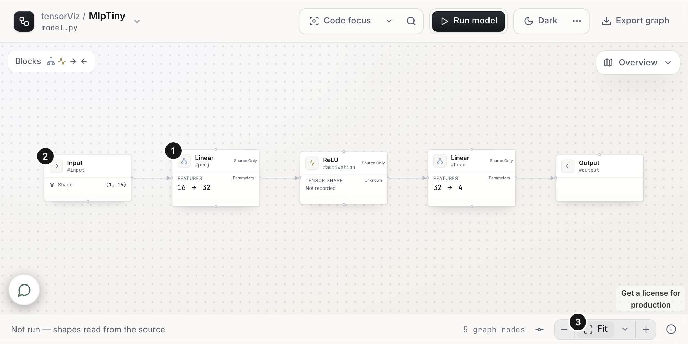

# tensorViz coding-agent plugin

The plugin lets Claude Code, Codex, or Cursor open a local PyTorch model, capture one forward call, and read the graph. It shows the same canvas as the editor extension. You do not need the extension to use the plugin.



Use one TensorViz host per agent. Do not connect the same agent to both the plugin and the extension.

## Install

Use your client’s terminal CLI. If it is not installed, start with the [installation requirements](install.md#plugin).

The published plugin is a preview for Apple Silicon macOS (ARM64) and Linux x64 (glibc >=2.31), with CPython 3.12 and CPU capture. It downloads a verified compiled runtime on first connection, so you do not need a separate Node.js installation. Allow internet access for that first download.

Codex:

```sh
codex plugin marketplace add tensorviz-org/tensorviz-plugins
codex plugin add tensorviz@tensorviz-standalone
```

Claude Code:

```sh
claude plugin marketplace add tensorviz-org/tensorviz-plugins
claude plugin install tensorviz@tensorviz-standalone --scope user
```

Cursor: follow [Install in Cursor](https://github.com/tensorviz-org/tensorviz-plugins#install-in-cursor).

For a local source archive, see [Codex and Cursor local installation](reference/agent-plugin.md#install).
Non-interactive Codex installation needs
`sh /path/to/tensorviz/plugins/tensorviz/scripts/install.sh --apply --host plugin`.
To keep a current connection, use `--apply --host existing --connection NAME`
with a name from the installer preflight.

T3 Code uses your Codex profile. See the [public catalog](https://github.com/tensorviz-org/tensorviz-plugins).

Start a new chat afterward. Platform limits and source builds are on the [Install](install.md) page.

Windows, Intel Mac, Linux ARM64, and musl are unsupported by the published standalone plugin. See [Linux SSH runtime](linux-ssh-runtime.md) for execution-host requirements and the limits of local validation. Published platform availability does not establish real SSH-network or installed-client acceptance.

## Update an existing Codex installation

Run both commands in the **same execution environment and Codex profile** as the
chat that will use TensorViz:

```sh
codex plugin marketplace upgrade tensorviz-standalone
codex plugin add tensorviz@tensorviz-standalone --json
```

Check the install result's `version` and `installedPath`, then start a new chat
(or restart the client). Refreshing the marketplace alone does not reinstall the
plugin: the listing can show the refreshed catalog version while an old cache is
still selected. Existing chats can retain their old MCP process and tool list.
Updating a Mac profile does not update a separate Linux/remote/cloud profile.

Version 0.3.104 was macOS-only. Version 0.1.43 supports glibc Linux x64 despite
its smaller version number, following the plugin/extension version alignment.
Do not edit cached launchers, mix releases, or disable runtime checks. If a fresh
chat still has no tools, inspect its MCP startup error and verify which installed
path it actually launches before diagnosing a model or capture failure.

## First graph

1. Open your model project in the client and start a new chat.
2. Ask, for example: "Open `Net` in `models/net.py` as a TensorViz graph."
3. When asked, choose a CPython 3.12 environment that can import the model, and confirm example inputs.

Opening a graph executes one forward call. Ask to **inspect source only** if you want a preview that does not run the model. Saved `tensorviz.toml` recipes are reused. After you edit the source, ask the agent to refresh the graph.

## Model graph panel

Ask the agent to show the **Model graph** panel. Clients without a panel can open the graph in a local browser page instead. An empty panel does not start Python.

The `graphPanel` capability in `list_models` describes server support, not proof
that your client can render a panel. An opener returns `displayed: false` and
`status: awaiting_view`; it is not a display receipt. Use the current view
receipt from `list_models` to verify display. If no panel appears, use `open_graph_view`
with the current model reference, open its returned private URL, and check its
display receipt instead of repeatedly calling `open_graph_panel`. At the eight-panel limit, another open expires the oldest opener that has never
connected, rather than asking you to close an invisible panel. Connected and
previously connected frames are protected from this capacity eviction; the
existing idle timeout still applies. Each opener retains a separate identity,
so clients that attach their app bridge later can still connect normally.

A replaced panel frame cannot reclaim the same opener with its old client ID. After 64 replacements, reopen **Model graph** to get a fresh opener; the current frame continues working.

Closing the panel does not cancel a capture or edit source. Reopen **Model graph** if it disconnects; the capture is kept.

## Publish to tensorviz.dev

**Publish**, in the panel and browser graph toolbars, adds the open graph to your
[tensorviz.dev](https://tensorviz.dev/explore/) account as private, as the editor
extension does. The first time, choose **Continue in browser** to sign in with Google.
Then open the graph's Share dialog to choose who can see it. Publish is a button in
the graph, not an agent tool. To sign out, run `node scripts/launch.cjs --sign-out`
from the installed plugin directory. Details: [Add graphs to tensorViz](share-to-website.md#publish-from-the-coding-agent-plugin).

## Permissions

On first use, TensorViz asks for permission to run model and setup code, save `tensorviz.toml`, and install reviewed dependencies in the selected environment. That permission applies to your OS user across projects; your client’s tool controls still apply.

- Model code runs with your user permissions.
- Graph text returned to the agent can become part of that client's conversation.
- Consent does not start a model on its own. Unknown inputs and interpreter choices still need an answer.
- Uninstalling the plugin does not delete the saved permission.

Disable the plugin in your client to stop that client from using its tools. Source-build status and revocation commands are in the [source-package reference](reference/agent-plugin.md#permissions).

## Help

| Problem | What to try |
| --- | --- |
| No tensorViz tools in a chat | Check that the plugin is enabled, then start a new chat |
| Duplicate tools | Disable the older TensorViz plugin or MCP entry. Keep one host |
| Python environment rejected | Select CPython 3.12 for this preview |
| Capture succeeds but no graph appears | Ask the agent to show the Model graph panel or open the browser graph |

More: [environment recovery](environment-recovery.md), [setup and inputs](graph-setup.md), [support and compatibility](https://github.com/tensorviz-org/tensorviz-plugins/blob/main/SUPPORT.md).

## Develop the plugin

Building from source, the source archive installer, service details, and panel limits are in the [plugin reference](reference/agent-plugin.md) and [plugin build](plugin-build.md).

## Runtime cache and slow first connection

New source candidates support `TENSORVIZ_RUNTIME_CACHE_DIR` in the MCP server
environment. Use an absolute directory for a task-specific verified archive
cache. This does not isolate the coding client's profile or TensorViz permission
and service state; configure those separately. The default archive location is
unchanged when this variable is absent.

If the first download exceeds the client's startup deadline, a new candidate's
launcher can prepare the archive without running it:

```sh
sh /absolute/path/to/plugin/scripts/launch.sh --prepare-runtime
```

A truly empty-cache check with Codex CLI 0.165.0 exceeded its 30-second MCP
handshake deadline while downloading published 0.3.109. A cached successful
connection does not cover this first-download failure. The new prefetch command
is an explicit recovery path, not a guarantee of cold-network startup.

Use the same cache for prefetch and the MCP server, then reconnect. The command
checks the pinned size and SHA-256 before returning, and does not extract or
execute the runtime. Published 0.3.109 does not contain this flag. For its first
Claude Code connection, `MCP_TIMEOUT=360000 claude` is a process-only timeout
option. Do not put `startup_timeout_sec` in portable `mcp.json`: Codex CLI 0.165.0
rejects that field and skips the server.
