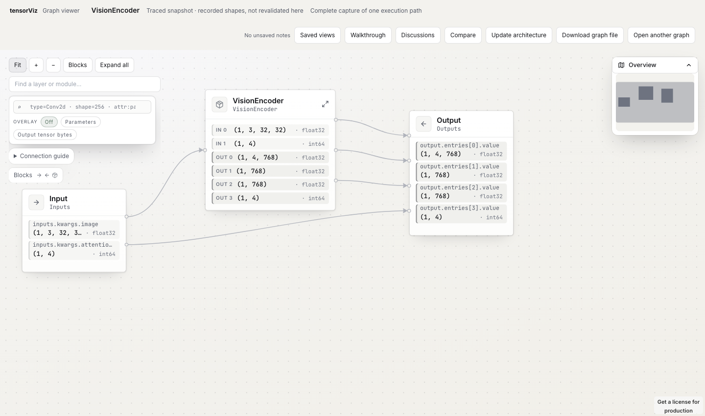
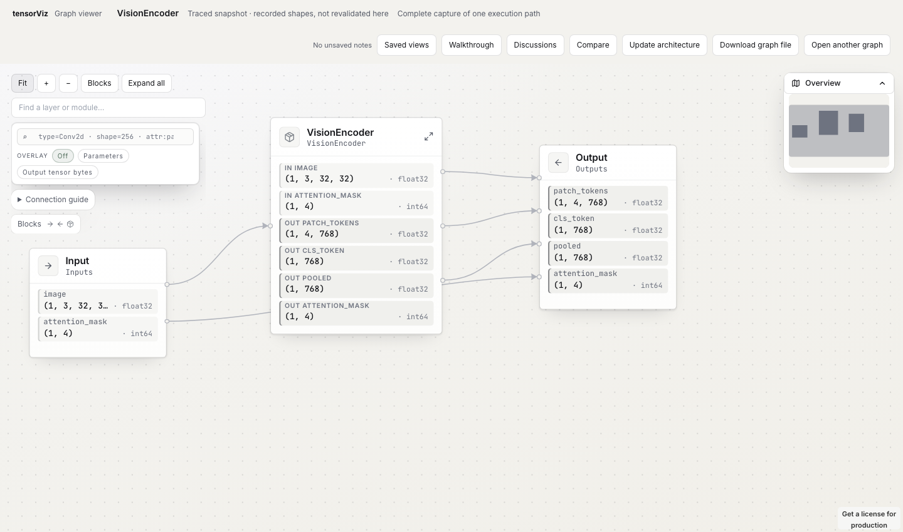

# Input and output names

Captured Input and Output cards, module boundary rows and port tooltips display
recorded dictionary keys and keyword argument names. A returned dictionary such
as `{"patch_tokens": tensor, "pooled": tensor}` shows `patch_tokens` and `pooled`,
with `Out patch_tokens` and `Out pooled` on the module. A keyword input such as
`attention_mask` keeps that name. Shapes and dtypes remain beside each value.

Unnamed positional inputs and tuple/list outputs use one-based labels such as
`Input 1` and `Output 3` (`In 1` / `Out 3` on multi-value module boundaries).
Nested containers preserve their structure, for example `states[0]`; punctuation
and non-string dictionary keys use bracket notation. Repeated input aliases remain
listed together. Tensor roles and positional Python parameter names are not guessed.

The optional `DisplayPort.displayName` is derived from the recorded argument tree.
Canonical paths, port IDs, values, edges, shapes and dtypes stay unchanged. The raw
capture paths remain available in captured details. The shared renderer covers
the extension, local browser, plugin panel and static graph-file viewer.

Older version-4 graph files recover names from their retained capture when opened;
saved display names are recomputed from that evidence. Live documents without names
use keyword names where present and concise numbered fallbacks for dictionaries.
They never show serializer paths such as `output.entries[2].value` on the cards.
Refreshing with the updated backend supplies the actual dictionary keys.

## Before and after

Both images use the same real captured `VisionEncoder` example, graph file,
positions and 1440×850 viewport in the production static viewer. Before uses
main `2d9190b0`; after uses this naming patch. No recapture occurred between images.
This is local viewer evidence, not the public site or an installed extension.

| Before | After |
| --- | --- |
|  |  |

[Narrow viewport](evidence/capture-boundary-names/after-narrow.png) was also checked
at 900×700 after expand → fit → collapse. Download preserved the capture and edges.

## Verification (2026-10-27)

The naming fix was adapted from tensorviz-extension commit `34ff2f6ca` onto this
repository's current `backend/` and `canvas/` layout. Current source-replacement
guards and schema fields are retained. Module rows now show actual names; unnamed
boundary values use one-based labels. Operation-card operand numbering stays as
before, while its tooltip uses the shared readable name.

Local checks passed, with no skipped tests:

- Full canvas suite: 3,295 tests in 183 suites.
- Backend document, contract and portable-capture suites: 136 tests, PyTorch 2.14.1.
- Source-edit API suite after refreshing 16 document fixtures: 96 tests. Only
  capture-port `displayName` fields changed; 132 frontend fixture-consumer tests
  passed after the refresh.
- Shared contracts: 119 tests; shared build and protocol/semantic/validation checks.
- Extension compile and unit tests: 1,652 tests.
- Production viewer build and Chromium QA at desktop and narrow sizes, including
  page identity, named cards/ports, expansion, and export identity. No browser
  errors, warnings, blank page or framework overlay.

The first frontend run had five missing compiled-host-fixture failures and one
expectation for the old raw tooltip. Compiling the extension helpers and updating
that expectation resolved them; the full 3,295-test rerun passed. Dependencies
were reused from matching lockfiles. Local Node was 26.5.0; the project's Node 22
CI environment was not run. Regular Playwright was used because the Browser plugin
was unavailable. This PR does not claim an installed extension/plugin run, GPU/JAX
capture, full backend suite, full TypeScript check, release or deployment.
GitHub Actions were kept idle; validation was local.

The fixture refresh follows producer-parity failures found by the companion
extension branch's broader backend run. This repository's full backend suite was
not run; the affected source-edit API suite passed here.
