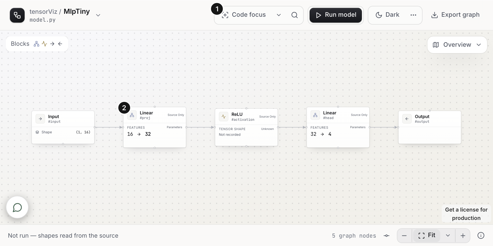

# Follow the code

Select a layer in the graph to find the Python that defines it.

**1 — Code focus:** enable the header control. **2 — Layer:** select a mapped layer to follow its Python. The screenshot uses the small MLP source example; source navigation opens in your connected editor.

## Jump to source

Switch **Code focus** on in the Canvas header. Selecting a node reveals its mapped source beside the graph. Use its verified file:line link to navigate explicitly; double-click or **Enter** on a leaf opens inspection.

With Code focus off, exploring the graph keeps the editor in place. You can still choose a node's file:line link to open its source explicitly. If the Canvas is maximized, showing source restores the split so the code appears beside it.

Double-click or press **Enter** on a module to enter it. Moving the editor cursor onto a layer focuses the outermost matching layer; a specific layer or operation line focuses that item.

## Dim unrelated code

1. Open **Code focus options** beside the header switch.
2. Enable **Dim unrelated code**.
3. Choose how much context to keep visible.

| Scope | What stays readable |
| --- | --- |
| Model / class | The enclosing model class |
| Function | The enclosing function |
| Node / expression | The mapped source lines |

Use **Surrounding code opacity** to make the rest of the file more or less visible. For a parameter card, **Parameter source** lets you keep its declaration, uses, or both.

This changes highlighting only. It does not edit source. Code focus is available in the editor extension and its browser view, and each remembers its own choice. The plugin browser and graph-file viewer do not offer Code focus; graph review has its own source navigation.

## If nothing is highlighted

The selected node needs a verified source location. Editing the file, starting a graph review, or clearing the selection clears old highlighting. Save and refresh the graph, then select the layer again.

[Open a model](graph-opening.md) · [Review changes](graph-diff-review/README.md)

Mapping rules and limits

[Code focus reference](reference/code-focus.md)

