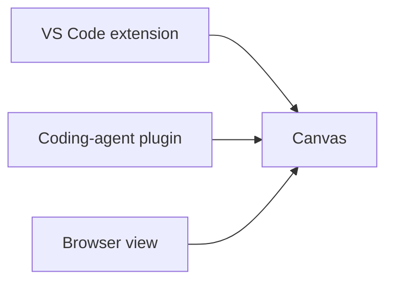

# Concepts

TensorViz draws one model as a graph. Three ideas cover most of the product: what a capture proves, which file holds what, and which host you are talking to.

## What a capture proves

**Open as Graph** constructs the model and runs one forward call with the saved setup, on the saved device. The graph is that call.

A capture does not prove:

- other inputs, batch sizes, or branches that this call did not take
- training steps, gradients over a dataset, or latency
- that every child of a module ran, unless the trace reached it
- a successful validation when the run failed, was refused, or was cancelled

Shapes from that call are measured. Shapes from source alone are static or declared, and they stay labeled that way. `# tensorviz: out_shape=` records a shape the trace did not measure. A source preview leaves unknown dimensions empty. It does not invent a default image size.

**Inspect source only** does not execute the model.

Saving a source edit refreshes the preview. A compatible edit can be captured again with the same `tensorviz.toml` profile. **Run model** on an already captured graph reviews another run. It does not silently replace the first capture's meaning.

## `.tensorviz.json` and `tensorviz.toml`

| File | Role |
| --- | --- |
| `tensorviz.toml` | How to build and call the model: constructor or factory, example inputs, device, mode, timeout. Opening a graph reads it. Saving setup from the Canvas writes it. |
| `.tensorviz.json` | A snapshot of a graph you export (`format: tensorviz.graph`). Architecture, optional notes, and, in version 4, the retained capture. It does not re-run the model. |

The export is not a `.graph` file. Details: [graph files](graph-files.md) and [saved profiles](model-validation-profiles.md).

## Three hosts

| Host | When it runs | How an agent connects |
| --- | --- | --- |
| VS Code extension | Editor is open. Also installs in Cursor and VSCodium. | Loopback MCP while you choose **Connect coding agent (MCP)**. The editor must stay open. |
| Coding-agent plugin | Claude Code, Codex, or Cursor, including when the editor is closed. | stdio MCP from the installed plugin. Build the archive first. [Plugin guide](agent-plugin.md). |
| Browser view | A page the extension or plugin opened on `127.0.0.1`. | Not a third agent. `open_graph_view` hands the agent a private link. [Security](mcp-security.md). |

Use one TensorViz host per agent. Pointing the same agent at the extension and the plugin registers two copies of the tools.

The activity bar title is **tensorViz**. Command titles look like **tensorViz: Open as Graph**.
