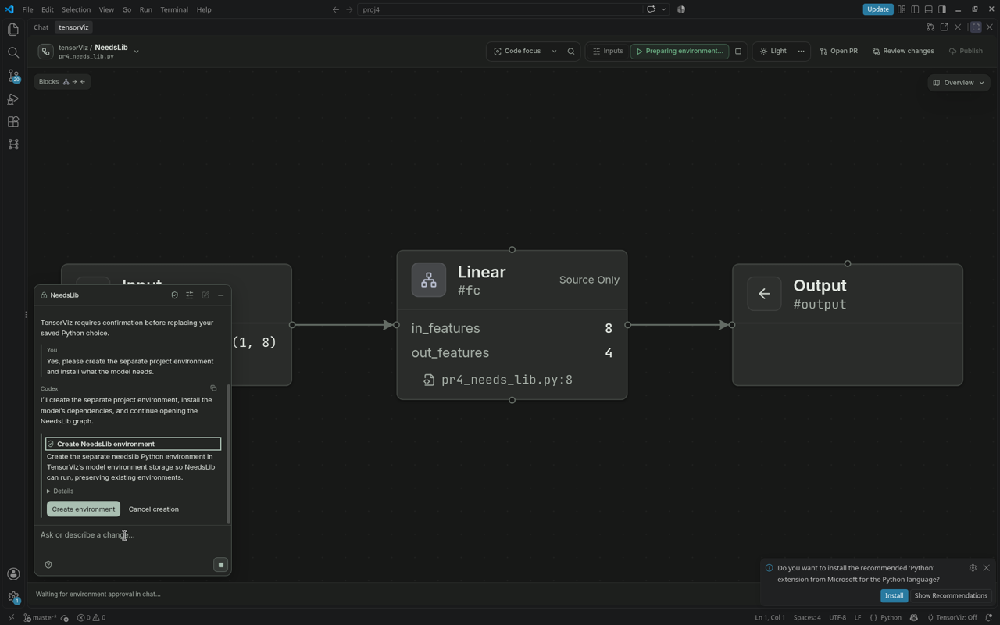

# Python environments

TensorViz needs Python to run your model and record tensor shapes. In the editor,
choose **Set up project with agent** to have your coding agent check the project,
prepare Python and test inputs, and continue to the graph. By default, chat asks
before creating an environment, building dependencies, or installing packages.
The agent explains each proposed operation and supplies its action labels. Expand
**Details** for the host-recorded operation, paths and exact versions.
**Stop** cancels a pending request.

The shield icon beside the composer opens this chat's permission menu. The current
mode is checked; hover or focus another mode for its explanation:

| Mode | What happens |
| --- | --- |
| **Ask every time** | Review each environment change. This is the default. |
| **Auto setup** | Automatically create an isolated environment and install its packages. Ask before source builds or changes to existing environments. |
| **Full setup access** | Automatically approve all supported environment setup actions, including source builds and existing-environment changes. |

While the agent prepares an explanation, the operation remains paused and no
approval button is shown. The generated explanation cannot change the operation
or grant permission. Automatic approvals appear as **Auto-approved** in the conversation. They record
permission, not successful installation. Changing the mode can approve a waiting
request when its action is covered; switching back affects future reviews, not
work already approved. New chats return to **Ask every time**. Source edits keep
their existing review. Machine commands always need explicit approval in every
mode, including **Full setup access**. Their **Details** show the exact executable,
arguments, working directory and timeout. They can access machine files and the
network; they run without a security sandbox.

The setup screen keeps the explanation short. Expand **Learn more** for how the
agent helps and the current setup details. The same sidebar shows **Python** and
**Model inputs**, with a check beside completed steps. If you close it, **Complete
setup** resumes the unfinished step and preserves your choices. Python completion is published as soon as its
checks pass. The same agent then continues to model inputs, saves setup and
captures the graph. If it needs a checkpoint, dataset or other missing choice,
answer in the same chat.

## Choose an environment

Choose **Set up manually** if you want to select Python yourself. Reuse the
environment that already runs your model, or create a separate model environment.
**Setup options** returns to the agent route without losing your manual choices.
You can also run **tensorViz: Select Python Environment**. For the plugin, tell
your agent which environment or interpreter belongs to the project.

**TensorViz Python** is the Python provided by TensorViz and shared across models.
Expand **Interpreter details** to inspect its complete path and version details.

Your model’s Python and TensorViz’s service Python can be different. Changing the model environment does not mean reinstalling the service.

On the first launch, **Setting up tensorViz…** prepares the service runtime.
Download progress shows received bytes and the total when the server supplies it;
updates continue as bytes arrive, followed by verification, unpacking and dependency
setup. You can cancel this preparation and try again later.

Saved Python choices belong to the model’s project root. A nested checkout or Python project has its own choice; unrelated models in the outer workspace keep their workspace choice. The saved environment row shows the project path.

When you open a model, TensorViz checks detected environments against the model’s libraries and recommends the one needing the fewest changes. An explicit choice is preserved. Save-triggered capture and Canvas agent help require a saved or configured environment; choose one explicitly if neither is available.

If only the project’s version pins differ, choose **Try with installed versions**. Through the extension’s MCP endpoint, follow the returned `open_graph` action `use_installed_versions` with the same `requestId`, `openingId`, and `sourceDigest`. This accepts the reported project pins for that project and interpreter during the session, installs nothing, and still checks capture-worker compatibility. Selecting the environment again resets the choice. For example, an old `torch==2.0.0` project pin can conflict with the worker’s supported Torch versions; try an already installed compatible version instead of downgrading to the pin. Standalone plugin hosts offer this action only when their returned environment includes `declaredPins`.

## Fix a setup problem

| Problem | What to try |
| --- | --- |
| Python is missing or incompatible | Select a compatible interpreter from the prompt |
| An import fails | Choose the environment where that library is installed, or review the proposed dependency setup |
| You need a new environment | Let the setup agent prepare it, or choose **Set up manually → Create model environment** and review the installation plan |
| TensorViz’s own service will not start | Run **tensorViz: Repair runtime** in the editor |
| The model fails during capture | Fix the reported Python error, save, and run again |

If setup fails, the same agent can inspect the actual exception, traceback and
observed Python/device facts, read the project's setup files, and request a
diagnostic command when needed. It checks the command's real output before
explaining the blocker. A new environment cannot fix an unsupported platform;
the agent must establish that cause from evidence. Expand **Error details** in
chat for retained error evidence. Animated dots beneath the latest message show
the agent working; they stop when the turn ends or needs your approval. Hover or
focus the indicator for details. Approval, stopped and error states remain distinct.

The published plugin preview requires **CPython 3.12 on macOS ARM64/x64, Linux x64 (glibc >=2.31), Linux ARM64 (glibc >=2.35), and Windows x64/ARM64** and targets CPU capture. See [installation options](install.md) for package requirements; [local setup](local-setup.md#versions) lists source-development versions.

## Before installing dependencies

Check the selected environment and the proposed packages. TensorViz keeps permission prompts in the setup flow; starting a graph is not permission to make every environment change.

[Open a model](graph-opening.md) · [Model inputs](graph-setup.md)

Environment discovery and recovery details

[Full environment reference](reference/environment-recovery.md)

### Interpreter picker consent

Opening **Select Python Environment** lists interpreter paths without running discovered
Python executables or checking the managed service. Python-extension suggestions use
already cached paths without activation or environment resolution. Version and library metadata stay
unknown until a selected interpreter is checked. Cancel preserves the previous choice.
Selection works before service setup; subsequent inspection and setup still require
Workspace Trust, a current target and the existing installation approvals.

