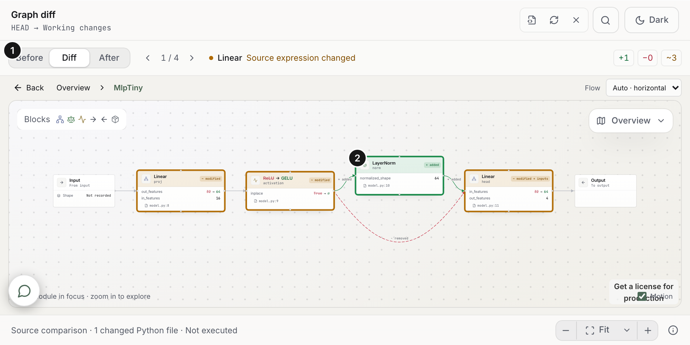

# Review model changes

Compare Python changes on the graph, with the code diff beside it.

**1 — Before / Diff / After:** choose which revision to inspect. **2 — Changed layers:** the review shows a wider projection, a new activation, and an added normalization layer. This is a source comparison; neither revision is executed by the review.

## Compare local changes

1. Open a Git-tracked model, edit its Python, and save.
2. In the Canvas toolbar, choose **Review model changes → Working changes** to compare with HEAD.
3. Read the native code diff beside the graph. Use **Before / Diff / After** and the change arrows to inspect the result.

You can also choose **Graph diff** from an open Python diff, or run **tensorViz: Review model changes** for working changes, branch changes, or two local revisions. In Source Control, **Changes** compares the index with working files, including unsaved buffers; **Staged Changes** compares HEAD with the index. **Graph diff against HEAD** compares HEAD with working files.

## Review a pull request

Choose **Open PR** and provide a GitHub.com pull-request URL or select a repository PR. Pick a model if the PR affects more than one. See [PR setup and supported cases](pr-workflow.md).

## Read the highlights

| Highlight | Meaning |
| --- | --- |
| Green | Added |
| Red | Removed |
| Amber | Source or parameters modified |
| Blue | Inputs or incoming connections changed |

Use **Before / Diff / After** when a source comparison offers them. Previous and next visit each affected captured call once and open its containing module. Moving the code cursor onto a line with one change focuses that change; ambiguous lines stay unselected. If code or the PR changes, use **Refresh graph diff** to update the review.

## What the comparison tells you

Graph diff compares source and **does not execute either revision**. An existing capture can provide context, but its shapes are not new before-and-after measurements. Models in nested projects keep their captured context when review starts from the containing Git checkout, in the extension and standalone plugin. See [project boundaries](../graph-opening.md#models-inside-a-larger-workspace).

Unmapped or ambiguous changes stay visible as unresolved. The review does not prove behavioral equivalence. Capture the changed model separately when you need runtime evidence.

[Open a model](../graph-opening.md) · [Edit a model](../source-editing.md)

Coverage, matching rules, and technical details

[Graph review reference](../reference/graph-review.md)

