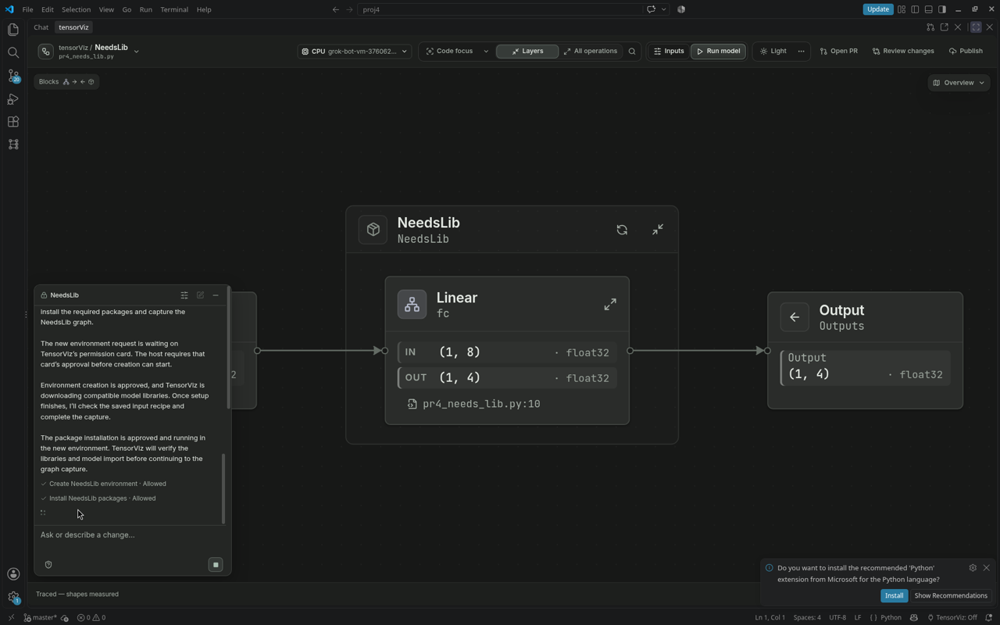

# Open a model

Open a PyTorch model in your editor or coding agent. For JAX and Flax, use the [framework guide](jax-support.md).

## In your editor

Start in the **tensorViz** panel beside chat. **tensorViz: Get Started** opens the
same panel; the extension no longer opens a separate welcome guide. Its starting
screen offers **Open Folder**, discovered models and runtime setup when needed.

1. Open the folder containing your model.
2. Click **Open as Graph** above the model class. You can also select it in **tensorViz → Models**, or run **tensorViz: Open as Graph**.
3. If setup is needed, choose **Set up project with agent**. The agent checks the project’s Python environment and inputs, requests approval for required library installation, and continues opening the same model.
4. Use **Set up manually** to choose Python and complete the inputs yourself. Existing saved setup is reused where compatible.

The starting screen's **Open as Graph** uses the active Python file, or a visible
Python editor or selected text tab when the panel has focus. Class choices stay
within that file. If no host Python file is selected, it offers workspace models.
The action above a class always opens that exact file and class.

Python and model inputs are steps in the same setup sidebar. Closing it leaves
one **Complete setup** reminder; returning resumes the unfinished step. The
completed Python selection and edited inputs are retained.

A complete setup is saved in `tensorviz.toml`. TensorViz captures one forward call and opens the graph beside your code.

**Inspect source only** opens a preview without running the model. A capture runs your local model code and describes only the inputs and mode you chose.

## In your coding agent

Install the [plugin](agent-plugin.md), start a new chat in your model folder, and ask:

> Use TensorViz to open my model and show its graph. Ask me for any missing Python environment or example inputs.

If several models are present, include the file and class name. Complete the permission and setup prompts.

## After an edit

Saving your model or a tracked dependency automatically validates the open model by default. TensorViz reuses compatible saved setup. To run only when you choose, set `tensorviz.traceOnSave` to `false`, then use **Run model** or **Run again**, review the setup, and choose **Run**.

An eligible identical CPU result can be [reused from the execution cache](execution-cache.md). A brief Python safety check still runs; **Run fresh** requests a new model execution.

Saves within 1.5 seconds are combined. Typing, unchanged saves, unrelated files, source-only inspection and open source reviews do not start runs. Accept/Apply saves and runs once; an unchanged save does not restart it.

Showing, hiding, or exploring the Canvas does not start another capture.

The first captured graph is sized from its child frames before its top-level
cards are placed once. Saved views and positions you move yourself are preserved
when the same graph refreshes.

## Choose a trace tier

`tensorviz.traceTier` applies to graph capture without a saved profile. `real` is the default. Experimental `fake` uses shape-only tensors and retries once with real tensors if values are needed. Experimental `auto` starts with real tensors, then uses fake tensors for models previously counted at 150 million parameters or more. A large model that needed a real retry stays real. Saved profiles, validation and reviewed candidates use real tensors.

## Models inside a larger workspace

A nested model uses its project root for imports, `tensorviz.toml`, generated helpers and capture. Starting at the model’s directory, TensorViz stops at the first `tensorviz.toml`, `pyproject.toml`, `setup.py`, `setup.cfg` or `.git`, or at a directory whose name cannot be a Python module component. It never searches above the owning workspace. Add project metadata at the intended root when the boundary would otherwise be ambiguous. Source links still open the original workspace files.

## If you get stuck

| What you see | Next step |
| --- | --- |
| No Python or missing libraries | [Choose or repair an environment](environment-recovery.md) |
| Missing constructor values or input shapes | [Set up model inputs](graph-setup.md) |
| A previous result is reused | [Run fresh or change cache mode](execution-cache.md) |
| Your model is not listed | Use **Choose a Python file…** in **Open as Graph** |

Discovery, prompts, and nested projects

[Opening reference](reference/graph-opening.md) covers model discovery, graph prompts, saved state, and project boundaries.

