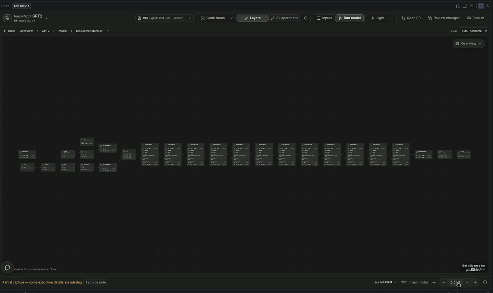

# Hugging Face weights and example captures

Run **tensorViz: Open Hugging Face model**, or use the cloud-download action in
the Models view. Paste a Hugging Face model repository or `.safetensors` link.
Repository, `blob`, `resolve`, and `tree?...show_file_info=...` URLs are supported.
Branches containing `/` must use an encoded revision segment, such as
`refs%2Fpr%2F2`. Subdirectory file links are supported.

## Explore without running

The explorer pins the repository commit and reads the eight-byte length prefix
and JSON header with two HTTP range requests. It does not download tensor data,
start Python, or execute a model. It shows:

- Nested tensor names, exact stored shapes, dtypes and byte counts.
- Search by tensor name, shape or dtype.
- Stored element count, file size and header size.
- Storage distribution across top-level weight groups.

The tree is a **weight hierarchy**, not an execution graph. Stored element counts
include the tensors in this file; they are not a unique trainable-parameter count.
Tied weights, buffers and omitted tensors make those concepts different. Storage
bars describe the checkpoint, not runtime memory.

The inspector supports a single file with an 8 MiB maximum header and up to
100,000 tensors. A server that ignores or changes the requested range is refused;
inspection never falls back to downloading the full checkpoint. For ambiguous
repositories, paste the specific file link. Individual shards can be inspected,
but are not treated as complete executable models.

Public files need no token. For a gated/private model, first obtain access on
Hugging Face. The host offers a password input for a read token after a 401/403.
A successful token is kept in VS Code Secret Storage. Tokens are never sent to
the webview, written into model files, or included in inspection results.

## Run an example

Expand **Run example inputs**. A neighboring `config.json` must declare a single
architecture available as an installed Transformers `PreTrainedModel` class.
The UI identifies the required class; availability is checked during loading.
Missing classes fail with guidance to use the model's local implementation.
Configs requesting custom code or quantization, missing/ambiguous architecture
declarations, and named checkpoint shards remain inspection-only.

Common text configs propose `input_ids` and `attention_mask` with a small sequence
length. ViT/DeiT/Swin configs with explicit image dimensions can propose
`pixel_values`. Other architectures need explicit named tensors. Each row selects
shape, dtype (`int64`, `float32`, `bool`) and fill (`zeros`, `ones`). These are
synthetic, model-ready inputs, not tokenization or audio/image preprocessing, and
are not guaranteed to satisfy every model's contracts. A failed example remains
a failed example; there is no automatic search or substitute input.

**Download & run example** requires a trusted supported workspace. It:

1. Downloads the selected file at the pinned commit into a new `hf_<model>_*`
   folder. Full downloads are cancellable and limited to 2 GiB.
2. Saves `weights/model.safetensors`, its `config.json`, and `huggingface.json`
   recording the original repository, commit, filename and size.
3. Saves an editable `model.py` wrapper and `tensorviz.toml` profile with the
   exact input choices, CPU/eval mode and gradients disabled. The config and
   weights are explicit `tracked_files` in the profile, so saved-profile checks
   include their file identities.
4. Invokes the existing **Open as Graph** flow. Python selection, dependency
   approval, profile resolution and captured Canvas use the normal extension flow.

The wrapper loads only local safetensors and installed Transformers code. It does
not enable remote Python or pickle loading. Missing, unexpected or mismatched
weights refuse execution instead of silently using randomly initialized layers.
Existing files are never overwritten. Cancellation/failed downloads remove only
the new incomplete import directory; saved files survive capture/setup failures.
Reopen the saved `model.py` with **Open as Graph** to reuse the download. Edit
inputs through Canvas or the saved profile for later captures.

Input tensors are limited to 4,194,304 elements in total. This is not a limit on
model allocations, intermediate tensors or loading memory. A CPU capture can need
considerably more RAM than the weight file's size.

## Boundaries

- `.pt`/`.bin` links are not imported. Use the existing local Python model and
  checkpoint/factory recipe flow. A state dictionary alone cannot define forward
  order, residual edges, activations, masks or arbitrary Python branches.
- Remote-code import, sharded-model assembly, tokenizer or processor download,
  an inference service, automatic package install, and GPU execution are outside
  this flow.
- The weight explorer is a VS Code editor view. The captured graph stays in the
  sidebar Canvas, with **Open Canvas in Browser** for a larger page. The plugin
  and a browser-only window do not import Hugging Face weights on their own.
- [Vogent-Turn-80M](https://huggingface.co/vogent/Vogent-Turn-80M) is a gated
  example: a custom Whisper/SmolLM classifier. With access, its safetensors can
  be inspected. Execution still needs that model's implementation and a
  multimodal input setup.

Format reference: [Hugging Face safetensors metadata parsing](https://huggingface.co/docs/safetensors/en/metadata_parsing).
Model reference: [Vogent-Turn-80M](https://huggingface.co/vogent/Vogent-Turn-80M).
