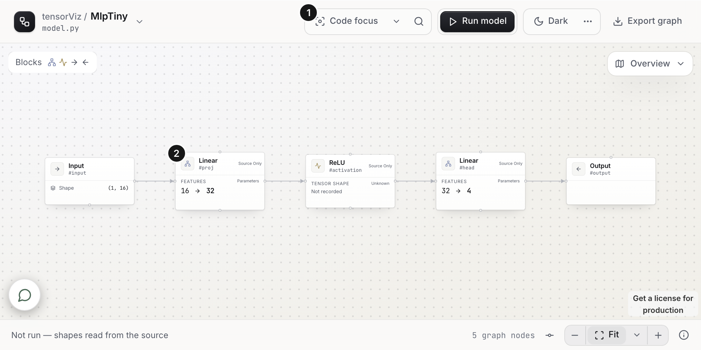

# Build from source

Use this guide to develop TensorViz or build your own package. To use a published package, see [Install TensorViz](install.md).



The repository is currently private. Cloning requires read access until it is made public.

Clone the repository first:

```sh
git clone https://github.com/tensorviz-org/tensorviz.git
cd tensorviz
```

Commands below run from that folder.

## Versions

These are the versions in this source checkout. Published packages have their own release versions; see [installation options](install.md).

| Piece | Version |
| --- | --- |
| Development Node.js | 22. CI uses Node.js 22. The plugin host requires Node.js 22 or newer. |
| Development Python | 3.12. CI uses Python 3.12. |
| Extension | 0.1.43 (`extension/package.json`) |
| Plugin host | 0.3.110 (`plugin/package.json`) |
| VS Code | 1.106 or newer (`engines.vscode` is `^1.106.0`). Cursor and VSCodium can install the same VSIX. |
| Backend service | Python 3.11 or newer (`MIN_BACKEND_PYTHON` in `extension/src/runtime.ts`, `backend/extension_environment.py`) |
| Capture interpreter | Python 3.10 or newer (`backend/capture_environment.py`). Expression-level source positions are not recorded on Python 3.10. |

`.python-version` is 3.12 and `.nvmrc` is 22. The Makefile asks for Node 22. Use those for the checks CI runs. The backend service still accepts Python 3.11 or newer, and a capture environment can be Python 3.10 or newer. `start.sh` refuses an interpreter older than 3.10 and says the repository pins 3.12.

## Tools

| Tool | Use |
| --- | --- |
| Node.js 22 and npm | Contracts, canvas, extension, plugin |
| Python 3.12 | Backend and capture development, matching CI |
| VS Code 1.106+ or Cursor | Extension development host |

## Install

```sh
npm ci
npm ci --prefix canvas
npm ci --prefix extension
npm ci --prefix plugin
python3 -m venv venv
./venv/bin/python -m pip install -U pip
./venv/bin/python -m pip install -r backend/requirements-cpu.txt pytest
npm run build:shared
npm run protocol:check
```

`requirements-cpu.txt` installs the CPU PyTorch wheel so a Linux install does not pull CUDA packages. `backend/requirements.txt` pins `torch==2.14.1`, `torchvision==0.29.1`, `fastapi==0.162.0`, `starlette==1.10.0`, `pillow==13.0.0`, and `onnxscript==0.7.2` (imported by the Torch 2.14 ONNX exporter). The CPU index publishes `torch` 2.14.1 with a local `+cpu` version, and `torch==2.14.1` matches that wheel.

## Run the extension

```sh
npm run dev:build --prefix extension
```

`dev:build` builds the webview before staging the backend, so it also works when `extension/media/app` does not exist yet. The VSIX build uses the same order.

Open this folder in VS Code, choose **Run tensorViz extension (examples/tensorviz-test)**, and press F5. That launch config opens `examples/tensorviz-test`.

`.vscode/launch.json` also defines **Run tensorViz extension (repository root)** for checks that need the whole checkout.

Point **tensorViz: Select Python Environment** at `venv/bin/python` when the picker does not find it. Open a model with **Open as Graph**.

`make gate` runs the wider local set (shared checks, docs links, backend, frontend, extension, plugin). `make gate-quick` is the smaller set. Say what you ran.

Canvas hot reload is the dev server (`npm start --prefix canvas`) with `REACT_APP_IDE=true`. The packaged sidebar uses `npm run build:webview --prefix extension`, which builds `canvas/` and stages it into the extension.

Graph projection keeps node and edge creation in the same tldraw batches. When the page is focused and every existing shape uses tldraw's default child-rejection behavior, the bridge supplies the page parent directly instead of searching the whole page for every new shape. Custom containers and focused groups keep tldraw's normal parent discovery. The real-Editor canvas regression test checks this against the installed tldraw version.

## Documentation website

Run `npm ci --prefix docs` and `npm run dev --prefix docs` for a local
preview. The documentation workflow builds on matching pull requests and main
updates. Deployment uses the isolated Firebase Hosting documentation project
and requires `DOCS_PUBLISH_ENABLED=true` plus the configured repository Actions
variables for the project, site, workload identity provider, and deploy service
account. Only trusted upstream `main` push or manual runs can deploy; fork PRs
only validate the docs. See the [documentation guide](documentation-site.md).

The docs header and favicon use the original mark from
[`canvas/public/favicon.svg`](../canvas/public/favicon.svg). Keep the three logo
assets in `docs/public/` aligned with it.

## tldraw key

Export `REACT_APP_TLDRAW_LICENSE_KEY` in the shell only if you have a key and you are building something you will give to other people. Do not write the key into the repository. Local development and the dev `package` script can omit it. Release packaging fails when the key is unset and does not print it: the extension script `package:release` and `node scripts/package.mjs --release` under `plugin/`. `npm run package:source-development --prefix plugin` stays unverified. See [licensing](licensing.md).

## Checks

```sh
npm run build:shared
npm run protocol:check
PYTHON=./venv/bin/python npm run semantic:check
PYTHON=./venv/bin/python npm run validation:check
npm run compile --prefix extension
npm run test:unit --prefix extension
npm test --prefix canvas -- --watchAll=false --watch=false --runInBand
cd backend && ../venv/bin/python -m pytest -q
```

Canvas unit tests are the `npm test --prefix canvas` command above. The canvas package does not define `test:hosted`, and CI does not run the hosted suite. These scripts remain and are not part of CI: `npm run test:ui2:guards --prefix canvas`, `npm run test:ui2:gate --prefix canvas`, `npm run test:e2e:all --prefix canvas`, `npm run test:e2e:substantive --prefix canvas`, and `npm run test:e2e:local-browser --prefix canvas`.

`semantic:check` and `validation:check` need `PYTHON=./venv/bin/python` so they import the backend dependencies. A VSIX needs the webview first. `npm run vsix --prefix extension` builds it:

```sh
npm run vsix --prefix extension
```

JAX and Flax capture tests skip unless `jax` and `flax` are installed in that environment. `backend/requirements-cpu.txt` does not install them.

Contract checks need the backend's Python dependencies (`pydantic`, and the rest of `backend/requirements.txt` if a contract import asks for them). `npm run semantic:check` runs the semantic contract check.

`make plugin-capture` requires the explicit service and pipless capture interpreters
listed in [capture-role tests](plugin-build.md#capture-role-tests). The template
sweep in `make gate` enables the supported inter-template adapters.

## Release checks

`npm run qa` writes a QA receipt. `npm run release` only checks that receipt: the commit, a clean tree, the artifact hash, the platform, and a current production renderer license. It does not publish. Publishing is the root script `release:publish`, which runs `node tooling/workflow.mjs release --publish` and needs `VSCE_PAT` plus `GH_TOKEN` or `GITHUB_TOKEN`. `extension/scripts/sync-github-release.mjs` and `extension/scripts/sync-openvsx-release.mjs` also refuse without `--publish`. Open VSX needs `OVSX_PAT` as well.

## Service bind

The default host is `127.0.0.1`. `start.sh` and `python backend/server_v2.py` call `ensure_safe_bind` before they listen. `python -m uvicorn server_v2:app` is checked the same way when the server starts (`install_uvicorn_bind_guard` in `backend/bind_policy.py`), including `--host 0.0.0.0` and `--lifespan off`, before that process creates its listen socket. A non-loopback bind is refused unless `TENSORVIZ_LOCAL_TOKEN` is set. `AUTH_DISABLED` does not allow a public bind. A DNS Host header is rejected. A numeric non-loopback Host is allowed only when that launch token is set. The IDE launch path still uses uvicorn on `127.0.0.1`.

When `TENSORVIZ_LOCAL_TOKEN` is set, unauthenticated `GET /health` keeps `device` and `capabilities` and omits Torch and Python versions and the library list. `/openapi.json`, `/docs`, and `/redoc` are not registered in that mode.

The plugin service (`backend/standalone_server.py`) binds `127.0.0.1`, requires a launch token of at least 32 characters, and does not bind `0.0.0.0`. `backend/auth.py` accepts `AUTH_DISABLED` (the dev principal) and then the local token. Any other credential, including a bearer token, is 401. Firebase Admin is not a backend dependency.

### Model Python and the local service

**Select Python Environment** saves the interpreter for model execution even when
service setup is pending, cancelled, or has failed. Workspace Trust is still
required. Selecting a model interpreter does not install or start the local web
service. **Open as Graph** requires the separate TensorViz service setup; approve
that setup or retry **Repair Runtime** after correcting its reported prerequisite.
The selected model interpreter retains its installed Torch/CUDA versions.

New TensorViz-owned Linux/Windows environments request Torch 2.14.1+cpu from the
official PyTorch CPU index. The extension also requests torchvision 0.29.1+cpu.
This CPU policy selects a new managed cache identity; existing live managed
and user environments are preserved. Missing CPU wheels fail setup without
falling back to a source build or a GPU distribution.
