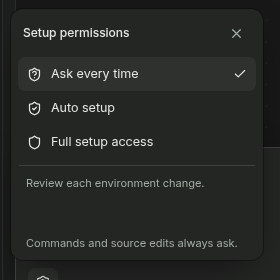
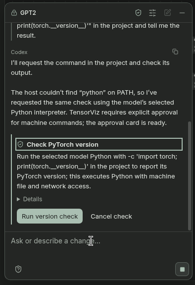

# MCP security

How the extension endpoint and the browser view are bounded. Connecting a client is [Connect MCP](mcp.md). Tool behavior is [MCP tools](mcp-tools.md).

## Contents

- [Loopback and no bearer token](#loopback-and-no-bearer-token)
- [Setup permissions and approvals](#setup-permissions-and-approvals)
- [Host and Origin](#host-and-origin)
- [Sessions and the lock](#sessions-and-the-lock)
- [SSH and forwarded desktops](#ssh-and-forwarded-desktops)
- [Browser view links](#browser-view-links)
- [Limits](#limits)

## Loopback and no bearer token

The extension MCP endpoint binds `127.0.0.1` only. There is no bearer credential. Other local processes can call tools while a session exists. Ordinary cross-origin web pages are rejected by the Host and Origin checks.

The plugin service (`backend/standalone_server.py`) also binds `127.0.0.1`, requires a launch token of at least 32 characters, and does not bind `0.0.0.0`. `start.sh` and `backend/server_v2.py` default to `127.0.0.1` and refuse a non-loopback bind unless `TENSORVIZ_LOCAL_TOKEN` is set. `AUTH_DISABLED` does not allow a public bind. A DNS Host header is rejected. A numeric non-loopback Host is allowed only when that token is set. With the token set, unauthenticated `GET /health` keeps device and capabilities and omits Torch and Python versions, and `/openapi.json`, `/docs`, and `/redoc` are not registered. Details: [service bind](local-setup.md#service-bind).

## Setup permissions and approvals

The chat's **Setup permissions** picker chooses how much environment setup an agent may do without asking: **Ask every time**, **Auto setup**, or **Full setup access**. With **Ask every time**, you review each environment change. Commands and source edits always ask, whichever mode is selected.

A machine command appears as an approval card in the chat. The card names the command and what it can access, and its buttons describe the action, such as **Run version check** and **Cancel check**. Nothing runs until you choose the run button.

## Host and Origin

Host and Origin checks apply to every HTTP method on the MCP endpoint. A browser view is a separate channel: the page proves itself with a one-time fragment credential, then a session cookie, and the socket must present the exact launch `Origin`. The launch token never goes to the browser. Routes and refusal order: [local browser broker](local-browser-broker.md).

## Sessions and the lock

The MCP server allows up to 16 sessions per window and expires a session after 30 minutes without a request. Clients initialize again after an expired-session response.

Port allocation and consent changes share a `proper-lockfile` lock. A crashed holder expires after ten seconds without a heartbeat.

Requests use JSON, with a 64 KiB body limit.

## SSH and forwarded desktops

Desktop Remote SSH supports an agent on the remote host and a desktop client you forward explicitly.

- An agent on the SSH server uses the server-side URL shown in the guide.
- **Forward MCP to This Desktop** returns a URL for a desktop agent. Add that URL yourself. Forwarded endpoints belong to the window that created them and must be recreated after the tunnel or SSH session reconnects. The shared remote endpoint still has the usual window takeover.

WSL, containers, Codespaces, and running the extension endpoint with no VS Code host are unsupported.

## Browser view links

`open_graph_view` mints a private URL. `create_view_link` in `backend/services/ide/local_browser_broker.py` sets the expiry to two minutes (`timedelta(seconds=120)`), and shorter if the workspace session expires first. Bootstrap removes that credential (`view_links.pop`), so the link works once.

Polls do not mint a new link or return the credential. An unopened link that expires returns `VIEW_LINK_EXPIRED`. Request a new link. Do not reuse the old URL.

After bootstrap, the page keeps its cookie and a non-secret tab hint, so a reload of that page is not a second use of the fragment. A graph change needs a new model reference. Handoffs belong to the MCP session that requested them.

The workspace session itself defaults to an 8-hour TTL, bounded to 1 second through 24 hours. That is not the two-minute view link.

Agents should stop waiting, say when a browser cannot be opened, and keep the raw URL out of answers and project files. MCP inspection still works without the browser. The native Canvas is not proof that an agent tab opened.

## Limits

Confirmed in the current tree:

| Limit | Value | Where |
| --- | --- | --- |
| MCP tool response | 512 KiB | `packages/graph-host/src/mcpGraph.ts` |
| Capture inspection page | 64 KiB | `packages/contracts/src/captureReader.ts` |
| Elements in one input binding | 4,194,304, at most 32 dimensions | `packages/graph-host/src/graphInputContract.ts` |
| Browser view link | 120 seconds, single use | `backend/services/ide/local_browser_broker.py` |
| Browser session TTL | 8 hours default, 1 second to 24 hours | same broker |
| MCP sessions | 16 per window, 30 minutes idle | extension MCP server |
| Lock staleness | 10 seconds | `extension/src/mcpLifecycle.ts` |
| Plugin graph panels | 8 panels, 5 minutes idle | `plugin/src/graphPanel.ts` |

Further paging and retention numbers for runs and proposals are in [MCP tools](mcp-tools.md).
