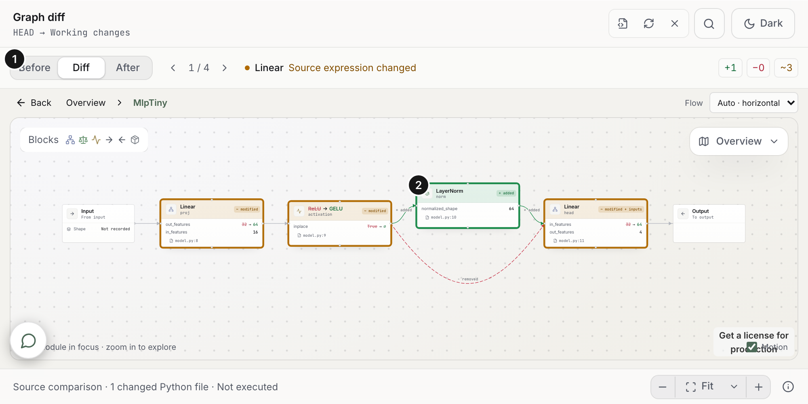

# MCP tools



## Contents

- [Fill missing inputs with your agent](#fill-missing-inputs-with-your-agent)
- [Open a graph](#open-a-graph)
- [Available tools](#available-tools)
  - [Show local changes in the graph](#show-local-changes-in-the-graph)
- [Protocol and implementation](#protocol-and-implementation)
- [Canvas views](#canvas-views)
- [Runtime input contract](#runtime-input-contract)
- [Retained execution inspection](#retained-execution-inspection)
- [Source proposals](#source-proposals)
  - [Recovered execution errors](#recovered-execution-errors)
  - [Source identity during execution](#source-identity-during-execution)
  - [Output limits](#output-limits)
- [Captured source proposals](#captured-source-proposals)

Arguments and results for the extension endpoint and the shared host tools. Connect a client in [Connect MCP](mcp.md). Transport limits and the browser link are in [MCP security](mcp-security.md).

`read_model_source` and `propose_source_set` are registered only for the canvas agent (`registerCanvasCodeTools` in `extension/src/mcpProposals.ts`). They are not in the table below. The plugin panel transport tools are listed in the [reference](reference.md#mcp-tools).

## Fill missing inputs with your agent

The call sequence is in [Connect MCP](mcp.md#fill-missing-inputs). Each binding is `{ args: [...], kwargs: { name: value } }`. A value is a JSON scalar, a `{ "kind": "float"|"none"|"list"|"tuple"|"dict" }` tag, or a tensor description:

```json
{"kind":"tensor","shape":[1,3,224,224],"dtype":"float32","requires_grad":false,
 "generator":{"kind":"normal","mean":0,"std":1,"seed":0}}
```

Generators are `normal` (`mean`, `std`, `seed`; floating only), `uniform` (`low`, `high`, `seed`; floating only), `randint` (`low`, `high`, `seed`; integer only, `low < high`), `full` (`value`) and `values` (exactly `product(shape)` literals; a bool tensor accepts only booleans). Dtypes are `bool`, the integers `uint8/int8/int16/int32/int64`, and `float16/bfloat16/float32/float64`. Shapes have at most 32 dimensions and 4,194,304 elements. `inputContract` states each rule explicitly; these bounds are not a substitute for reading the model's own `forward`.

## Open a graph

`open_graph` is available before a model is open. Pass an absolute Python `file`
and `cls`, or omit them to use the active editor. A file with several model
classes returns their names.

The tool opens Canvas and uses the same setup and capture flow as **Open as Graph**.
Saved profiles are reused. Poll the returned `requestId`; polling does not start
another capture. When inputs are missing, submit `draft` with `requestId`,
`openingId`, and `sourceDigest` to save `tensorviz.toml` and continue.

`continuationRequired` and `nextAction` mean the opening is not finished. Keep
going in the same task while that flag is true. A source-only preview is not a
completed capture. `nextAction` names the tool, arguments, and any values you
still have to supply. `action: select_environment` uses a listed `candidateId`.
With no saved choice and exactly one environment inside the model's folder,
`nextAction` already includes that candidate's ID; sending it is still the
selection. `action: refresh_environments` only refreshes the list.
`action: install_dependencies` uses the returned requirements; the editor still
asks before it installs. `action: use_installed_versions` continues with installed
versions when only the project's own pins differ. `action: cancel` stops this
connection's opening. `action: retry` resolves setup again. After an error, change
the setup or environment before retrying the same arguments.

When the model raises an error during its forward pass, the opening fails with
`opening.failure.kind: "execution"` and keeps a partial capture of the calls before
the error. `nextAction` then points at that evidence (`get_model_context` with a
module `focus`) and the model source, not at dependency repair.

If you cannot proceed, call `open_graph` with `action: report_blocker`, the
current request identity, and `blocker: { reason, evidence, nextStep }`. A
blocked request returns `status: blocked` and `continuationRequired: false`.
Only a successful capture returns `validated: true`.

One endpoint can see every local tensorViz window. `open_graph` routes an
absolute file to the window that owns it. Ambiguous matches return
`HOST_REQUIRED`; pass `hostId` to choose a window. Requests belong to the MCP
connection that started them. Disconnect cancels that connection's pending work.

`get_execution_environment` reads the interpreter tensorViz will use for capture.
It does not install packages or open a picker. Install missing libraries into
that interpreter. Do not switch to the agent's shell Python because an import
failed. Agent-supplied URLs, local paths, and pip directives are refused. The
user approves the exact package versions before installation. Declining, a
source change, or a disconnect stops the next step. A failed install never
reports a validated graph.

A source change during opening returns `status: source_changed`. Save, then
start a fresh request for the same file and class. That is different from
`cancelled`, which stops.

## Available tools

| Tool | Input and result |
| --- | --- |
| `open_graph` | Start opening a file/class, poll progress, submit missing inputs, retry or cancel through one session-owned request. See [open a graph](#open-a-graph). |
| `open_graph_diff` | Open Git HEAD versus current Python files in Canvas and the native code diff, including staged and unsaved edits. Optional absolute `file`, `cls` and `hostId`; returns the selected model, changed files and source coverage notes without execution. |
| `get_execution_environment` | Read TensorViz's resolved interpreter, selection source, prefix, Python/Torch/pip versions and platform without opening a graph or an environment picker. |
| `get_graph_setup` | Opening progress and source-only discovery of constructor/input fields, examples, configuration types, factories and enclosing models. Available before a graph exists. |
| `suggest_graph_inputs` | Pending setup packaged for an LLM: model file/class, constructor and input fields with annotations/defaults, examples, constraints, unresolved values, the exact draft skeleton to fill, and `inputContract` (the tensor/generator/dtype grammar). Source-only. |
| `configure_graph_setup` | Current opening id/source digest and an explicit draft; saves setup and continues one forward capture. Poll `get_graph_setup` for progress or missing fields. |
| `list_models` | Every live graph in every tensorViz window, each model id, revision, owning host, source identity and freshness; canvas view ids are tagged with their host. |
| `get_graph` | Model id/revision; summary or paginated nodes/edges. Optional node ids select an internal subgraph. |
| `list_captures` | Model id; latest attempt and retained complete/partial/displayed capture identities, including manual/browser runs. |
| `inspect_capture` | Model id, capture/source ids and a paginated path; exact operations, calls, argument trees, values, state, effects, coverage and diagnostics. |
| `get_model_context` | Current model id/revision; compact recorded module calls, aliases, registered parameter counts and tensor shapes. Defaults to 4,000 UTF-8 bytes; exact `focus` and `maxBytes` retrieve omitted modules. See [model context](model-context.md). |
| `get_selection` | Model id/revision and a view id from discovery; selected nodes and real connections. |
| `focus_view` | Model id/revision, view id and nodes or one edge; expands ancestors and waits for a canvas receipt. |
| `validate_model` | Model id/revision and positional tensors or explicit execution setup (fixtures, keyword inputs, constructor/factory/checkpoint, device/mode); returns a run id. One forward capture. |
| `get_run` | Run id; progress, originating source/input context, outcome and resulting projection reference. |
| `inspect_run` | Run id; immutable graph, failing operation and input shapes, contributing operations, module coverage, source and execution setup. Paginated; works after the live graph changes. |
| `compare_runs` | Two completed execution run UUIDs, not capture ids; returns comparison data, without opening a visual Git diff. Canonical arguments/effects/sharing and exact operand uses, with separate observations, setup and numerical outputs. Explicit uncertain correspondence; paginated, no execution. |
| `propose_edit` | Model id/revision and one typed source edit; captured nodes require a listed edit capability. Returns a proposal id for native review. |
| `get_proposal` | Proposal id; preparation/review/outcome and native diff metadata. |
| `run_proposal_candidate` | Proposal id and retry UUID; explicitly runs the exact copied review with its retained setup. |
| `cancel_proposal_candidate` | Proposal/run ids; cancels only that candidate and waits asynchronously for cleanup. |
| `list_proposal_candidates` | Proposal id; private retained native/MCP candidate summaries. |
| `inspect_proposal_candidate` | Proposal/run ids and optional capture query; summary or exact paginated canonical evidence. |
| `inspect_applied_proposal` | Proposal id; read confirmed Apply, current source/save state and later capture effects without execution. |
| `cancel_run` | Run id; cancels only the calling session’s validation. |
| `inspect_nodes` | Model id/revision and node ids; parameters, source references, shape provenance and paginated connected edges. |
| `send_feedback` | Plugin only. The user's message, `kind` (`bug`, `idea`, `other`) and optional `includeGraph`; sends feedback to the tensorViz team only after the user approves the exact report, in the client's confirmation form or by a second call with `confirmationId`. See [send feedback](share-to-website.md#send-feedback). |

### Show local changes in the graph

Ask: **“Show my local changes in the TensorViz graph.”** The agent should call
`open_graph_diff`, without recapturing the model first. It uses the retained Canvas
model or active Python editor; `file` and `cls` select a specific model. `hostId`
selects the VS Code window when routing is ambiguous. A local Git commit is needed;
the code does not need to be pushed to GitHub.

The tool opens the existing comparison and preserves a matching captured graph as
context. Results contain `status: opened`, the selected and available models,
changed files and source coverage notes. It returns after preparing and opening
the comparison, without waiting for Canvas rendering confirmation or reporting
displayed change counts. Green marks additions, red removals and amber modifications.
Unmapped edits remain in the change navigator; zero mapped highlights do not prove
that the source is unchanged. Retained shapes describe the earlier capture.

This action reads source without saving, applying proposals or running the model.
For an edit that has not been made, use `propose_edit` first: the user reviews the
native code diff and chooses Apply or Discard. After Apply, `open_graph_diff` can
show the accepted source change. Accept/Apply saves only reviewed files and opens the model with its current saved setup.
`compare_runs` compares existing execution records and cannot open this Git review.

Inspection never executes Python. The endpoint rejects stale revisions, missing
node ids and ids from an unavailable host; tools for a model owned by
another window are routed to that window. Refresh discovery after editing the source.
Unknown shapes stay unknown; observed shapes read the worker’s recorded tensor dimensions.
Declared shapes retain `declared` provenance and unreached nodes have no measured output.
Canonical source coverage also preserves `not_observed`, `capture_limited`,
`static_only`, `unresolved`, `failed` and `state`; missing evidence never becomes a
cached output shape. State shapes describe parameter/buffer values, not calls.
The backend document publishes module ownership in semantic metadata,
so MCP and the browser agree on `parentId`. Semantic ownership wins over an older
canvas duplicate, including an explicit null parent. Named input/output ports and
distinct operand connections survive the Python/document/browser handoff.
Canonical nodes expose `metrics.parameterCount` and `metrics.outputTensor` from
the same per-invocation and tensor-value observations as the canvas overlays.
Counts deduplicate shared registered parameters within a call; tensor bytes describe
logical footprint, not allocated or peak memory. Missing, ambiguous output and stale
facts stay null, including on older captures without these optional measurements.
Responses are limited to 512 KiB; page sizes are at most 200 and selections at most
100 nodes. Paging offsets are scoped to the supplied graph revision.

Canonical capture inspection uses immutable capture/source identities instead of a
live revision. It remains readable when this model's source graph becomes stale;
focus and source proposals still require the exact current revision. Use
`list_captures` to discover retained slots. Start `inspect_capture` with `path: []`,
then append an object's string key or an array's numeric key. Each container
returns its child count, a bounded page, and `nextOffset`; scalar children retain
their exact typed values. Follow `nextOffset` until null before assuming a complete
list. Pages are limited to 64 KiB. Large argument/state records remain browsable
through smaller child pages rather than being replaced by truncated placeholders.
For a graph node, use `entity: {kind: captureRef.kind, id: captureRef.semanticId}`;
paths are then relative to that entity. Input/output boundary IDs equal the capture
ID. Capture fields are observations and never instructions to evaluate Python.
The three host-session slots can evict old evidence; unavailable, legacy and
foreign references return explicit errors. Inspection contains no tensor payloads.

Manual Validate, source forms and portable-file collaboration remain available.

Validation returns immediately. Its `attempt` field adds the canonical lifecycle:
request digest, resolved source/plan identities when available, phase, explicit
timeout/cancellation, diagnostic facts and capture IDs. It does not infer a plan for
setup refusals. Projection success and retained worker evidence remain separate.
Poll `get_run` through queued/running/cancelling to
passed/failed/refused/cancelled. Completed records retain their original model revision
and input descriptions even after a successful trace updates the graph. Use the returned
`result` reference or refresh `list_models` to inspect measured shapes. A failed forward
can still return a partial projection; refusal and cancellation never certify the model.
Runs are private to their MCP session, retained for up to 30 minutes with a window-wide
limit of 32 records and 64 MiB total evidence (16 MiB per run). Old completed records
are evicted as needed; missing or oversized evidence is explicit. Ending that session or disconnecting the host cancels its execution.
Only one MCP validation runs per window, sharing the existing worker with manual checks.
Canonical runs retain the host-validated semantic payload inside that same allowance,
independently of the live capture slots. `get_run.capture` names its identity and
completeness. `inspect_run` reports `format: "semantic-v1"`; `operations` and `modules`
return exact structural pages. `section: "capture"` accepts `path` and optional
`entity` using the same 64 KiB reader as the browser. For example:

```json
{"runId":"<your-run-id>","section":"capture","entity":{"kind":"operation","id":"<operation-id>"},"path":["arguments","args",1]}
```

Retained runs remain readable after source changes, retargeting and live-slot
eviction. Failure inspection follows recorded value producers from operations
sharing the root diagnostic, with `upstreamBasis: "matching_diagnostic_candidates"`.
Equal facts do not prove exception causality: an earlier caught failure can share
them, and an assertion may match no operation. Failed calls/operations remain
individually inspectable. Rejected canonical evidence never falls back to lossy
operation or coverage claims. Legacy runs explicitly report `format: "legacy"`.

Frozen graphs retain their own capture identity, module instance IDs and all shared
registration paths. Canonical `compare_runs` uses the shared semantic comparer. It
returns `format: "semantic-v1"` and three-valued `equivalentCapturedComputation`:
true for matching recorded computation with complete coverage/correspondence, false
for known differences, or null when evidence is insufficient. This is independent
of numerical equality, weights and unobserved paths. A mixed/rejected canonical pair
reports unavailable; it cannot fall back to the legacy layer comparer.

`nodes` pages exact changed fields and unresolved fields. `connections` compares
individual argument/effect/result uses, including two separate operands in `a + a`.
`correspondence` pages established pairs, unmatched records and uncertain groups.
Numeric container indices and indistinguishable repeated operations remain unresolved.
Graph node/edge IDs are supplied only when retained capture references resolve
uniquely. `observations`/`coverage` stay distinct from computation changes.

Each collection page stays below 60 KiB; inline values are bounded to 4 KiB and
larger fields provide an explicit size descriptor plus `baselineInspect` and
`candidateInspect` requests for the exact `inspect_run` tree. These display bounds
do not affect comparison. There is no canonical first-intermediate-value divergence
claim: canonical metadata alone cannot establish it. Legacy comparison is labelled
`format: "legacy"` and retains its older fingerprint behavior.

Save model/dependency buffers first and grant VS Code Workspace Trust. Execution uses
the chosen environment and existing Torch/CUDA versions. `open_graph` can request
model dependencies, but installation requires native VS Code approval of a frozen
additive plan. It never replaces existing packages. The worker has the same 180-second process limit as manual Validate;
the complete validation operation is cancelled after 210 seconds.
When a package has no compatible wheel, source builds need approval before package
build code runs, followed by review of the resulting installation plan. A missing
PyTorch wheel is reported as `PACKAGE_UNAVAILABLE` instead, because PyTorch has no
source distribution to build. Dependency repair stays in TensorViz's reported
capture environment.

Environment recovery in Canvas and MCP shares the retained model opening.
`select_environment` accepts a listed candidate ID; `refresh_environments` checks
metadata only. Known missing libraries return their exact reviewed-install action.
An unexpected failure supplies a copyable direct MCP investigation request and
the originating attempt context. See [open a graph](#open-a-graph)
and [environment recovery](environment-recovery.md).

All connected views receive progress and the measured projection. Completion reuses
Validate’s node sweep: observed nodes glow green, mapped failures red, and unreached
nodes stay unverified. Cancellation/refusal or an outdated source cannot replay a pass.

## Protocol and implementation

The endpoint implements standard initialization, tools/list, tools/call and session
termination using the official MCP SDK. Requests use JSON, with a 64 KiB body limit.
Host and Origin checks apply to every HTTP method. The server allows up to
16 sessions per window and expires sessions after 30 minutes without a request.
Clients should initialize again after an expired-session response.

VS Code owns source buffers, workspace/model/view identity, review, Undo and
execution. Python services parse, transform and trace. The browser owns presentation.
Source changes must remain Python proposals for native Apply/Discard review.

Packaging bundles the SDK into `out/extension.js` via `extension/scripts/bundle-extension.mjs`;
no `node_modules` tree or separate runtime is installed by the user. Agent setup
parsers are bundled too; the JSONC parser uses its ESM entry so its internal
modules are included in the VSIX. Their license notices ship in
`extension/MCP_PARSER_NOTICES.md`.

## Canvas views

`list_models` includes broker-assigned view ids and whether each selection matches
the current source. Each browser connection has its own id; reconnecting replaces
it. Pick the intended view explicitly when several pages are open. `get_selection`
refuses stale, oversized or unavailable selections. Display-only collapsed edges
are not semantic connections; expand their block before selecting an edge.

`focus_view` accepts either up to 100 node ids or one semantic edge id. It expands
ancestor blocks, selects the requested content and fits it at a readable zoom.
The result is successful only after that exact page confirms focus against the
same source revision. A closed, stale or unresponsive page yields an explicit error.
This changes presentation only; it never changes the Python model.

## Runtime input contract

The trace worker accepts structured positional tensors (`shape`, `dtype`, `fill`).
Shapes have at most eight positive dimensions; requests contain one to eight tensors
and at most 4,194,304 elements total. Supported dtypes are float32, float64, float16,
bfloat16, int64, int32 and bool. Fills are zeros, ones and deterministic randn (floating
point only). Legacy tensor descriptions start on CPU. Alternatively supply `execution` (and omit
`inputs`) to use a workspace fixture, keyword tensors, constructor arguments/model
factory, checkpoint, explicit device and train/eval/preserved mode. The fields
are a [tensorviz.toml profile](reference.md#tensorviztoml). Explicit execution never
falls back to another interpreter. Input bounds apply; the model itself can
still allocate memory or execute arbitrary workspace code, so Workspace Trust and
worker cancellation/timeouts remain required. Arbitrary expressions are outside
the MCP input contract. Named workspace setup functions are explicit trusted-code execution.

Worker argument validation runs before Torch, Pydantic or the model is imported;
the ingestion package defers its public exports until they are requested.

## Retained execution inspection

`inspect_run` accepts `runId`, `section`, `offset` and `limit` (1–200). Sections are
`summary`, `graph`, `setup`, `capture`, `failure`, `operations` and `modules`. The
canonical `capture` section also accepts an optional `entity` and JSON-tree `path`.
Each collection returns its own count and next offset. Graph pages name their snapshot revision;
the run keeps its originating revision separately.

Legacy failure inspection returns all captured input tensor shapes, the failing operation's
source and paginated upstream producers. Module coverage distinguishes entered,
completed and unreached modules. A Python error outside a tensor operation has no
invented failing operation; its workspace traceback remains available. Error types,
cause types and missing module names are structured; arbitrary exception text,
stdout and stderr are not forwarded to clients.

The legacy worker bounds operation evidence to 8192 operations, 4096 module calls and 64
tensors per operation. It retains the failure even if earlier evidence was truncated.
A truncation flag and missing upstream count disclose incomplete paths. Setup pages
include input/state identities and paginated tensor metadata. These measurements
describe that one captured call.

Inspection runs no Python and does not require the current graph revision. Completed
records are immutable. Cancelled/refused runs can retain useful captured facts but
cannot certify the current model. Source, setup, fixture and checkpoint changes are
checked before presenting a current validation result.

## Source proposals

`propose_edit` accepts one `set_param`, `add_layer`, `remove_layer` or `group_layers`
intent. Use semantic node ids from this graph revision. Parameter values are bounded
literals; the tool accepts no source text, expression evaluation, arbitrary paths,
automatic Apply flag or shell commands. Unsupported source constructs return a useful
refusal; the agent can edit Python normally and let the live graph refresh.

Poll `get_proposal` for preparing, review, applied, cancelled or refused. During review,
the result identifies the native diff’s file, title and before/after digests. Shared
source definitions and grouping’s parameter/checkpoint key changes are disclosed in
that title. The user chooses **Apply source change** or **Discard proposal** in VS Code.
Apply is a single undoable WorkspaceEdit; native Undo restores it. The same freshness,
Workspace Trust and dependency checks used by browser forms apply to MCP proposals.

For captured edits with a retained resolved setup, explicitly **Run reviewed
candidate** in the native diff or call `run_proposal_candidate`. `get_proposal` includes a bounded
`review.candidate` summary separating runtime outcome, freshness, capture coverage,
actual input/state equivalence, cleanup and semantic postconditions. Literal, activation, reconnection and unary edits
include bounded `postconditions` evidence tied to the candidate execution, capture
and exact source binding. `verified` covers that observed expression only;
`failed` means a captured operand or recognized activation differs, and `unavailable` gives a closed reason
such as partial capture or an unsupported recipe. Other executions are unverified.
Older or unexecuted summaries retain `not_checked`. The retained run keeps the same
evidence after Apply/Discard, with source freshness and historical status separate.
Activation counts include every observed call at the functional or constructor
expression, including shared instances. Unused instances and other inputs remain
unverified; incomplete write/alias evidence cannot certify an in-place replacement.
Reconnection resolves the requested source variable separately in each candidate
call and checks the selected argument use. A correct first occurrence cannot hide
a later mismatch; original-run value IDs are not candidate correspondence.
Insertion checks the exact activation call and its original input, and requires
its output to feed the selected argument. An activation elsewhere is insufficient.
Deletion checks the exact replacement name and the full surviving flow in each
observed forward call. Its evidence binding points to that forward definition;
absence of the old operation alone cannot verify the edit.
Source Apply status stays separate: applying a static-valid edit cannot turn a
failed candidate into a successful run. Reading a proposal never executes anything.

`run_proposal_candidate({proposalId, requestId})` returns immediately with a candidate
record and `runId`. Generate a UUID `requestId` for an intentional run and reuse it
when retrying a lost response. Retries return the same run after review closes; an
evicted result reports unavailability without reexecution. Requests made during a
pending run share it. Up to 128 request IDs are remembered per proposal; reaching the
bound refuses new requests while existing retries remain readable. Runs execute
trusted Python in a copied workspace; Python can still access absolute paths and
services. The tool advertises execution side effects and never applies source.

Poll `inspect_proposal_candidate({proposalId, runId})` for runtime and cleanup status.
`cancel_proposal_candidate` targets that exact run; an older run cannot cancel a newer
one or discard the source proposal. `list_proposal_candidates` includes native Run
actions too. Apply/Discard waits for cleanup through the same native lifecycle.

To inspect a capture, copy `candidate.capture.captureId` and `sourceId` into the
optional `query` of `inspect_proposal_candidate`, starting at `path: []`. Use child
paths and `nextOffset` as with `inspect_capture`. Canonical JSON is immutable; pages
preserve exact argument order, repeated value uses, state and coverage. Private
candidate records cannot be focused in the live graph. Capture-less construction
failures still retain a runtime summary.

History is bounded to 32 runs, 16 MiB per capture, 32 MiB total and 30 minutes after
completion (start for unfinished runs). Payload eviction/oversize/validation failures
leave explicit reasons in the summary. Closed reviews are historical: freshness is
the last review observation, not certification of the edited buffer or environment.
Session ownership is checked before every control or read; another client's proposal
or run IDs grant no access. Proposal eviction, session termination, revocation and
host disposal forget associated evidence. Late worker completion cannot restore it.

After native Apply of a captured edit, `inspect_applied_proposal({proposalId})`
returns `applied`: the confirmed receipt, `checkedAt`, current source/save state,
capture-setup freshness and recorded effect comparison. Unsaved reviewed bytes,
saved reviewed bytes, restored original bytes and other edits are distinct. Only
the latest finished post-Apply capture participates; a newer failed/no-capture run
cannot borrow an older success. Observed effects, input/state identity and partial
dependency scope remain independent. Without a retained resolved setup, current
environment freshness is unavailable even when the recorded effect is verified.

This read neither saves nor runs the model; save and explicitly validate separately.
It uses bounded private source evidence (24 MiB/receipt, 32 MiB total, 32 records,
thirty-minute access lifetime) and fixed safe errors. Native source writes and
historical candidate results remain unchanged. Ownership is checked again after
reading; revocation, expiry and cancellation prevent a late result granting access.
The ninety-second host deadline includes static setup checks. Results describe the
instant checked, not continuing certification, and source restoration does not
prove that native Undo occurred.

One native source review is allowed per window, shared with the browser. Discard or
finish it before making another proposal. Disconnecting the owning MCP session or host
cancels pending work. A proposal expires after 30 minutes. Completed results are private
to the originating session and remain readable after source changes, with at most 32
records retained for up to 30 minutes. There is no MCP tool for automatic application.

The extension has no provider settings, API-key commands or built-in agent panel.
External agents own their model access. Native source editing and traceback links
remain independent of MCP. Git graph diff is a separate Canvas review, not an
execution comparison.

The browser protocol accepts only typed source proposals and validation requests;
old chat messages and free-form source-chat intents are rejected. Request results
remain private to the originating browser view, with cancellation on disconnect.

Broker regression tests also cover concurrent source reviews and validation requests: a reply of the other kind cannot consume a pending request.

The Python backend does not load provider clients, agent frameworks, or chat
endpoints. Its project and managed-runtime requirements omit those packages.
Graph projection, deterministic source transforms and trace workers remain available.
Packaging refuses AI runtime/router files and still excludes user environment files.

To verify a clean backend environment, install `backend/requirements-project.txt`
in a separate venv, then run `python backend/scripts/check_provider_free_runtime.py`.
It refuses environments containing provider frameworks, starts an authenticated local
HTTP server, checks removed routes return 404, projects source that would raise if
executed, prepares an edit without writing the file, and runs a separate real trace.

### Recovered execution errors

Module calls distinguish completed and failed invocations, including exceptions
caught by a parent before a successful fallback. Failed calls have no invented
outputs. A recovered tensor exception remains in operations and
`lastObservedFailure` with its disposition; it is not the run's terminal failure.
An exception linked through the final Python exception chain is labelled as such;
otherwise its relationship to a failed run is unknown. Eager call instrumentation
is removed after both successful and failed tracing.

### Source identity during execution

Save changed Python buffers before starting an explicit execution. The worker
records the exact workspace source bytes compiled by standard Python imports,
including helpers imported by setup, forward and loss functions. It compiles
source directly instead of trusting cached bytecode. The host checks these file
identities and unsaved buffers before presenting a current validation result,
including after graph refresh. A changed helper leaves the immutable run available
but refuses certification of the current source. Imports are bounded to 4096
source loads and 64 MiB; workspace bytecode-only imports are refused. Installed
packages are environment dependencies. Custom loaders, dynamic `exec` and arbitrary
data/configuration reads are outside this source-identity guarantee.

### Output limits

Worker stdout is capped at 32 MiB and stderr at 1 MiB. Exceeding either stops the
worker and produces `OUTPUT_LIMIT`, without claiming a model failure or parsing a
partial result. Run setup inspection pages input/state entries, module modes,
imported sources and checkpoint key differences separately. Follow each collection's
`nextOffset`; a byte budget may shorten the requested page. A single record larger
than 64 KiB is explicitly unavailable in legacy record paging. Canonical records
use structural child pages, so large records remain traversable without truncation.

Canonical live graphs expose `captureRef`, `captureLabel`,
`capturedOperationCount` and `typedPorts` in graph/node inspection. Each typed port
keeps its ordered argument path, value identity, shape, dtype and device. Edges
include `captureEdge` with the original value-use record; equal endpoints do not
deduplicate distinct destination arguments. Graph summaries include capture/source
identity, status, omissions and operation/invocation counts. Existing model/revision
guards and result-size bounds still apply. Full argument/value/state paging is
available through `inspect_capture`, `inspect_run`'s `capture` section and the browser’s **View captured details** dialog,
using the same host inspector.

Canonical graphs mark each recorded failed operation/call directly. Missing source
calls remain not-observed, capture-limited or unresolved according to their actual
coverage; a missing graph node never proves an untaken branch. Legacy graphs attach
a mapped failure badge only where their retained module evidence is unambiguous.

## Captured source proposals

`inspect_nodes` returns `sourceEditCapabilities` and `sourceEditLimitation` for
captured nodes. An exact `binary_scalar_v1` capability enables `propose_edit` with
`kind: "set_literal"`, its node id, `capabilityId` copied from the capability's `id`,
and its exact `target`, `argumentPath`, `expected` and `scope: "source_expression"`.
Supply `value` as `{kind: "int", value: "2"}` or a finite tagged float. Integers are
decimal strings to preserve precision; float negative zero uses `value: "-0"`.

`straight_line_tensor_v1` enables `kind: "reconnect_argument"`. Copy the capability
id, exact target, `argumentPath`, `expected` ValueRef and `scope: "source_expression"`;
choose a `value` ValueRef from its `choices`. This selects one operand use even in
`a + a`. Do not submit a variable name, source expression or layout-based producer
selection. Available values are proven against source order across the captured
shared calls; this does not establish shape compatibility. Native review checks
that the patch changes only that operand to the chosen name. See [captured tensor reconnection](reference/source-editing.md#captured-tensor-reconnection).

`straight_line_unary_insert_v1` enables `kind: "insert_unary_op"`. Copy the exact
target, argument path, expected input ValueRef and expression scope, and choose
`value` from `relu`, `gelu`, `silu`, `sigmoid`, `tanh`. It wraps only the selected
named operand with the nonmutating functional call. A declared fresh import is
included in native review when needed; do not send import text or options.

`straight_line_unary_delete_v1` enables `kind: "delete_unary_op"`. Copy its target,
`argumentPath: ["args", 0]`, expected output ValueRef and expression scope; use
its `input.value` as `value`. It bypasses only the proven functional call to its
original named input, preserving assignments. It cannot substitute another tensor
or remove a surrounding expression.

A `functional_activation_v1` capability enables `kind: "replace_activation"`.
Copy its `id` into `capabilityId`, its `target` and string `expected`, and use
`scope: "source_expression"`. Choose string `value` from the capability's
`compatibleActivations`, drawn from `relu`, `gelu`, `silu`, `sigmoid` and `tanh`.
This recipe needs a proven functional namespace/direct import, one positional or
`input=` tensor and supported literal options. It does not take an `argumentPath`, a function name
chosen by the client, source code or import requests.

`module_activation_v1` uses the same intent and activation values with a captured
`invocation` target. It replaces the verified constructor of the
selected activation module. Copy the capability verbatim; do not replace its
invocation id with an underlying operation. The host checks exact class spelling
and constructor range. All shared uses are disclosed and edited together.

Authored options are preserved. Explicit `inplace=True` or `False` restricts
replacement to ReLU/SiLU; true retains the proven input/alias mutation contract.
Explicit GELU approximation permits only a no-op until that option is changed
in source. Copy the capability's compatible choice; do not request extra option
changes or silently discard an incompatible option. A syntax-checked source
proposal is not evidence that the changed model has executed.

For direct imports, an optional capability `importPlan` declares a required Torch
namespace import when no safe existing namespace is available. The host verifies
that exact insertion and shows it in the same native diff. Do not add `importPlan`
or source text to the intent. Existing alias imports and their other uses are
preserved, and no-op requests add no import.

The edit affects every execution of that source expression, including unobserved
uses. A capability is tied to one captured source revision and cannot be reused
after retargeting. The host re-derives the recipe, checks source/configuration
dependencies and opens the native diff; only native Apply writes source. Preparation
is static and does not validate new tensor shapes. No-op requests report unchanged
source. Other captured operations cannot use the legacy layer-edit intents. See [authority and transport](reference/source-editing.md#authority-and-transport).


`constructor_scalar_v1` enables `kind: "set_constructor_literal"` for an invocation.
Choose one of its returned capabilities and copy `id` to `capabilityId`, plus
`target`, `sourceArgumentPath`, `expected` and `scope: "source_expression"`; supply
a tagged numeric `value`. `sourceArgumentPath` addresses saved constructor syntax,
for example `["args", 1]` or `["kwargs", "p"]`, and is unrelated to forward ports.
The host rejects substitution of a different field even when both fields currently
have the same number. The review changes one exact token. Tensor shapes and
checkpoint compatibility may change; no runtime validation or automatic adjustment
of other layers is implied. Custom classes and class aliases require observed direct
class identity for every instance sharing the source site. Configuration references
and general factory callables remain unsupported by this numeric recipe.

`configuration_scalar_v1` enables `kind: "set_configuration_literal"` for an
invocation whose constructor reads a proven direct numeric configuration name.
Copy `capabilityId`, `target`, `sourceArgumentPath`, `expected` and
`scope: "configuration_definition"`; supply the tagged numeric `value`. This
changes the same-file definition, preserving the constructor's reference. It
potentially affects all references, including unobserved uses, and reports known
source references and observed constructor sites/instances/calls/operations.
Changing a same-valued field's source path without its capability is rejected.
The native diff explicitly labels the definition and all-reference scope.
Parameters/defaults, imports, attributes and computed definitions need other
recipes; never substitute a measured value at an unsupported constructor use.
Preparation checks syntax only. Save and explicitly validate to obtain new runtime
evidence, which can legitimately reveal changed shapes or checkpoint incompatibility.

## Source context and computation queries

An exact call or declaration selector can also return `documentation`: a normalized
declared signature, cleaned author docstring, qualified name and source declaration
anchor, or an explicit unresolved reason. This is static source evidence, available
without an agent. It does not inspect a live Python object or execute imports.

`query_source_context` follows bounded lexical dependencies in the live model and graph-recorded workspace Python files. Start with a file/symbol anchor, then follow pages and explicit boundaries. It distinguishes defaults, possible links and unresolved expressions from runtime observations. `assumeValue` performs supported conditional integer arithmetic and reports constructor, reshape/view, flatten and LayerNorm shape effects under the captured conditions. These results do not establish full forward or checkpoint compatibility.

Retained capture queries can find computation entities and traverse canonical value/operation relationships with bounded depth and pages. Capture/source identities pin the evidence; projected layout edges are not substituted for runtime tensor flow. Unsupported shape rules remain unknown.

The Canvas-owned agent additionally has `read_model_source` and `propose_source_set`. Complete replacements are limited to existing graph-recorded workspace Python files, with exact before digests, at most 16 files, 256 KiB per file and 1 MiB total. External MCP clients do not gain arbitrary file writes or automatic Apply.

Candidate inspection adds read-only `outputs` and `checkpoint` evidence. Checkpoint loading, forward success, output equivalence and source freshness are separate outcomes. Failed loads remain inspectable after review closes. Inspection does not start another worker, and candidate results never certify a later edited live buffer. Training, optimizer and experiment diagnostics are unavailable.
