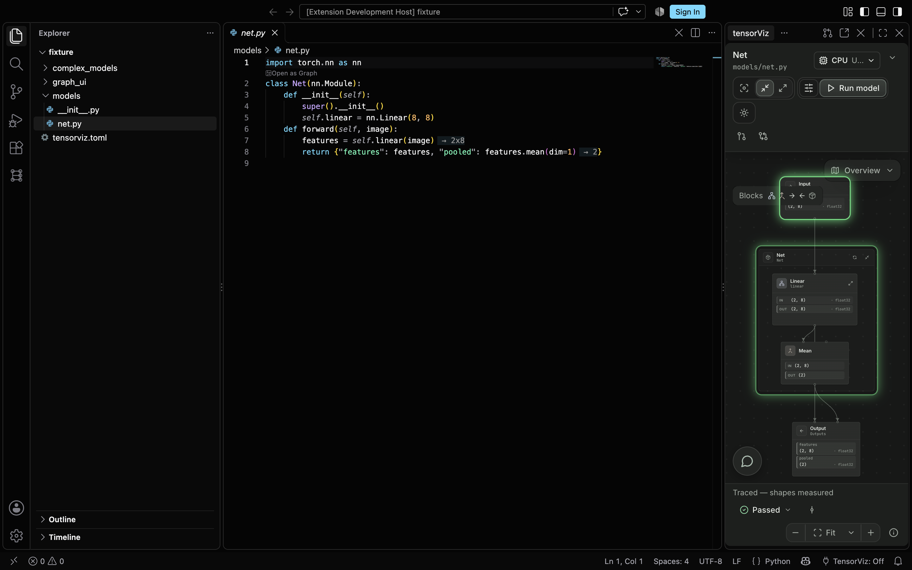

# Readable boundary names release — 2026-10-27

**Published:** [tensorViz 0.1.19 on GitHub](https://github.com/tensorviz-org/tensorviz/releases/tag/v0.1.19).
The release contains the tested VSIX and its SHA-256 file. Its extension ID is
`tensorviz.tensorviz`. A separate Marketplace/Open VSX listing has not been
published by this release; the existing store product uses `tensorviz.tensorviz-vscode`.

Source and tag target: `f397a99a72d2eb4f62b8040c94c0db9f02eb34ec`.
Commit author and committer: `tensorviz <tensorviz.app@gmail.com>`.
The manifest and both lockfile version fields are 0.1.19, with matching changelog,
version table and generated reference.

## Artifact and installed verification

- Package: `tensorviz-0.1.19.vsix`, 5,317,949 bytes.
- SHA-256: `f7772e62e5983c121f00398c95e276b4b44ab2287f2072c8330cc132f1199e4f`.
- GitHub reports the same digest for the uploaded artifact.
- The canonical VSIX build passed compilation, backend staging and archive checks.
- Both bundled renderers carry a valid signed all-host trial license expiring
  2026-12-26, supplied in memory from the existing TensorViz release. No key value
  was written to source or a local environment file.
- This exact VSIX passed an installed test in stock VS Code 1.143.1 on macOS arm64,
  using a disposable profile and fixture. A saved CPU model captured on open,
  rendered five nodes, and displayed `image`, `features` and `pooled` instead of
  serializer paths. The fixture used PyTorch 2.14.1.

The first launcher invocation used an obsolete `Electron` executable path. Reading
VS Code's bundle executable (`Code`) resolved the harness setup; the installed
check then passed. No product source change was needed for that retry.

The source checks are recorded in [the naming change](capture-boundary-names.md):
3,295 canvas tests, 136 focused capture/contract tests, 96 source-edit API tests,
119 shared-contract tests and 1,652 extension unit tests passed. The two frontend
fixture-consumer suites passed again after fixture regeneration (132 tests).
This release does not certify Windows/Linux installed behavior, GPU execution,
JAX runtime execution or a full backend gate.
